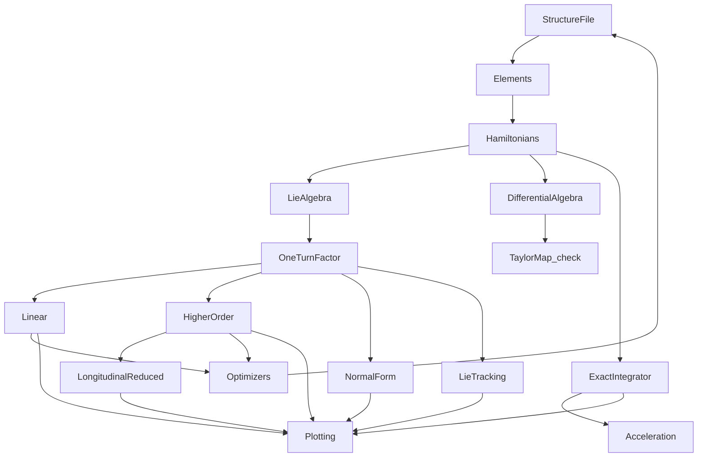

# Bell architecture

**Author:** Kolokolchikov Sergey Dmitrievich  
**Email:** sergey.bell13@gmail.com

Bell is a Julia program for symplectic modelling of a magnetic ring. The
object of the ring is a product of Lie transformations. Linear optics and
higher-order numbers are readings of that product. A truncated Taylor map
is an independent check of the same Hamiltonians; it does not define the
ring.

This page describes the program: blocks, how they call each other, the two
six-dimensional propagators, and the structure file. Physics is in the
Beam Physics Manual.

## Blocks



| File | Block | Role |
|------|--------|------|
| `src/coordinates.jl` | Coordinates | Particle, reference, canonical `(x, px, y, py, l, δ)` and the exact map to laboratory angles |
| `src/elements.jl` | Elements | Data types only: drift, sector bend, quadrupole, sextupole, thin RF, finite cavity, marker |
| `src/structure.jl` | Structure | Named parameters, element cards, sequence of names, `Lattice` |
| `src/hamiltonians.jl` | Hamiltonians | Exact `s`-Hamiltonian of each element, expanded as a polynomial |
| `src/lie_algebra.jl` | Lie algebra | Poisson bracket, Lie series, Dragt–Finn factor, product of factors |
| `src/differential_algebra.jl` | Differential algebra | Independent RK4 Taylor map of the same `H`. Check only |
| `src/linear.jl` | Linear | Degree-1 reading: `R = exp(:f₂:)`, Twiss, dispersion, `α_c` |
| `src/higher_order.jl` | Higher order | Readings of the one-turn polynomial: `D₂`, `η`, chromaticity |
| `src/normal_form.jl` | Normal form | Homological equation on the generators; torus average of `δ` |
| `src/tracking.jl` | Lie tracking | Flow of each truncated factor; thin RF kick |
| `src/exact_integrator.jl` | Exact integrator | Unexpanded `H`, Yoshida midpoint, finite cavity |
| `src/longitudinal.jl` | Longitudinal | Averaged turn-by-turn motion in `(φ, δ)` from already-read `η` |
| `src/acceleration.jl` | Acceleration | Reference ramp through the exact integrator |
| `src/optimizers.jl` | Optimizers | Optional change of named strengths; never part of the model |
| `src/plotting.jl` | Plotting | Figures. No physics |
| `src/symplectic.jl` | Symplectic | `Jᵀ S J − S` |
| `src/optim_converter.jl` | Converter | Writes a structure file from an OptiM `.opt` |

A script loads a structure file and calls readers. An application of a
concrete ring lives outside this package and depends on it.

## Where the orders come from

Linear optics and higher-order optics are homogeneous pieces of one
one-turn Lie factor

```text
F = R ∘ exp(:f₃:) ∘ exp(:f₄:)
```

`observables(lat)` builds that factor once. Twiss and `η₀` come from
degree 1 (`F.R`). `D₂` and `η₁` come from degree 2 of the polynomial of
`F`. Chromaticity `ξ₁` comes from degree 3. The RK4 Taylor map is not
used for these numbers.

An element in the structure file is a card of parameters. It is not a
procedure that writes into a global map. `hamiltonians.jl` writes `H`.
The Lie algebra builds a factor from `H`. Differential algebra repeats
the flow of the same `H` as a truncated polynomial and stops there.

## Two six-dimensional propagators

Both live in `(x, px, y, py, l, δ)`. Neither lives in the reduced
longitudinal model.

**Lie tracking** applies an already-built Dragt–Finn factor: the flow of
`f₄`, then `f₃`, then the matrix `R`. A thin RF cavity is a separate
canonical kick. There are no terms above the stored polynomial degree.
The factor does not depend on `s`, so a finite cavity whose field varies
along `s` is not this propagator.

**Exact integrator** integrates Hamilton's equations with the unexpanded
`H` (square roots, not a polynomial) by a symplectic implicit midpoint
composed as Yoshida's fourth-order jump. It does not cut a polynomial
order; it cuts the step in `s`. It is the propagator for a finite cavity
and for a ramp of the reference energy. After the cavity,
`renormalize` makes the synchronous particle the new reference.

Full six-dimensional motion is already here. Truncation exists only in
Lie tracking and equals the factor order.

The exact integrator reads `H`, not the factor. Reading the factor would
turn the finite cavity and the ramp back into a truncated map.

## Reduced longitudinal model

`longitudinal.jl` does not track the ring in 6D. It is the smooth
turn-by-turn Hamiltonian in `(φ, δ)`:

```text
dφ/dn     = −2π h (η₀ δ + η₁ δ²)
dδ/dn     = (Z V T / (β² E)) (sin(φ_s + φ) − sin φ_s)
```

`η` is taken from the higher-order reading of the Lie factor. The ring
product does not use this model. Synchrotron tune, separatrix and bucket
height are readings of this `H`.

## Structure file

Three parts in one file. The sequence holds names only. Numbers of an
element sit on its card. Named parameters sit above the cards so an
optimizer changes a name, not a line of the sequence. A quadrupole is
written once. The sequence repeats its name as many times as the magnet
stands in the ring.

```text
reference
  particle deuteron
  kinetic_MeV 270
  harmonic 1

parameters
  L_d = 2.0
  k_f = 0.3

elements
  D1   drift        L = L_d
  QF   quadrupole   L = 0.4    k1 = k_f
  QD   quadrupole   L = 0.4    k1 = -k_f
  B1   sbend        L = 1.5    angle = 0.3926990817

sequence cell
  D1 QF D1 B1 D1 QD D1 B1

sequence
  16 * cell
```

Units are those that already enter the Hamiltonian:

- length: m
- bend angle: rad (`deg` on a card is converted when the file is read)
- `k1`: 1/m², `k2`: 1/m³
- RF voltage: MV per unit charge; phase: rad; harmonic: integer
- kinetic energy and rest energy: MeV

Magnetic rigidity is not stored. It is computed from the reference
particle. `16 * cell` repeats an already expanded list of names. There
are no loops, conditions or matching commands.

`load_structure` builds a `Lattice`. `convert_optim` writes this file
from an OptiM `.opt`. The OptiM reader does not assemble a `Lattice`.

## Coordinates kept by Bell

Independent variable: arc length `s` along the reference orbit.

Canonical variables, used in every Hamiltonian and every map:

```text
z = (x, px, y, py, l, δ)
px = Px / p0,   py = Py / p0
l  = −v(δ) dt     [m]
δ  = (p − p0) / p0
```

Laboratory angles `(x', φ)` are input and output only:

```text
x'  = px / ps
φ   = −h ω₀ dt     (late particle: dt > 0 ⇒ φ < 0)
```

## Install

From the `Julia` folder:

```julia
using Pkg
Pkg.activate(".")
Pkg.instantiate()
using Bell
```
