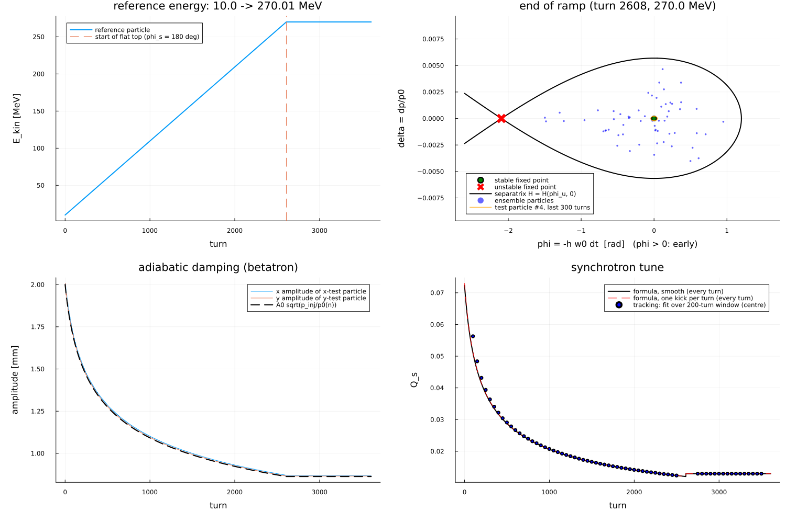

# Acceleration and adiabatic damping

After the cavity the synchronous particle has ``\delta_s\neq 0``. It is made
the new reference:

```math
p_0'=p_0(1+\delta_s),\quad
1+\delta'=\frac{1+\delta}{1+\delta_s},\quad
p_x'=\frac{p_x}{1+\delta_s},\quad
p_y'=\frac{p_y}{1+\delta_s},\quad
\Delta t'=\Delta t-\Delta t_s.
```

Positions are unchanged. Magnets are assumed to ramp with ``p_0`` (normalised
strengths fixed); the RF frequency follows ``h\omega_0(p_0)``.

The physical transverse momentum ``P_x=p_0 p_x`` is invariant under a
longitudinal field, so ``p_x\propto 1/p_0``. The Courant–Snyder action in
normalised variables then scales as ``J\propto 1/p_0``, and betatron
amplitudes damp as

```math
\frac{A(n)}{A(0)}=\sqrt{\frac{p_{\mathrm{inj}}}{p_0(n)}}.
```

