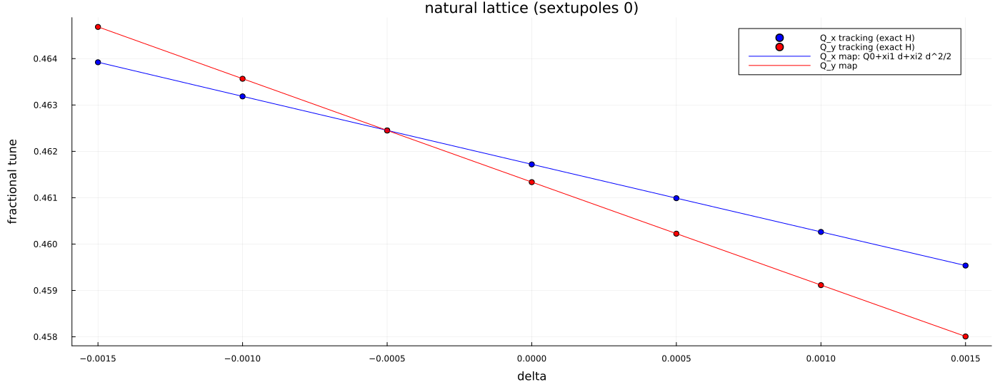

# Chromaticity

Chromaticity is a reading of the one-turn polynomial, not a descendant of
the Twiss functions. At fixed ``\delta`` the transverse motion about
``z_\perp(\delta)`` is linearised. The tunes ``Q_{x,y}(\delta)`` from
``\cos 2\pi Q=\tfrac12\mathrm{Tr}J(\delta)`` expand as

```math
Q(\delta)=Q_0+\xi_1\delta+\tfrac12\xi_2\delta^2.
```

Since ``\delta`` is conserved without RF, these are invariants of the
one-turn map. Cross-check: integrate the exact Hamiltonians at several
``\delta`` and fit the tune of a small betatron oscillation.

