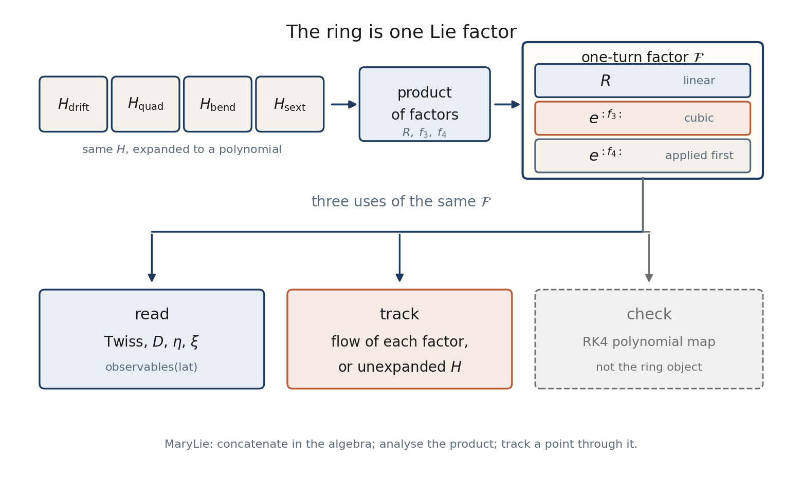

# Beam Physics Manual

**Author:** Kolokolchikov Sergey Dmitrievich (`sergey.bell13@gmail.com`)

Program blocks and the structure file: [Architecture](architecture.md).

Symplectic modelling of a magnetic storage ring with an RF cavity.
The independent variable is the arc length ``s`` along the reference orbit.
All dynamics are written in **canonical** phase-space variables; laboratory
angles and RF phase appear only as derived output.

The object of the ring is a product of Lie transformations, not a stack of
transport matrices and not a truncated Taylor map. Each element has one
Hamiltonian. That ``H`` becomes a Dragt–Finn factor
``R\circ e^{:f_3:}\circ e^{:f_4:}``. Concatenation in the algebra produces
the one-turn factor ``\mathcal{F}``. Twiss, slip, chromaticity and the
normal form are readings of ``\mathcal{F}``. Tracking applies
``\mathcal{F}`` to a point. An RK4 polynomial map is kept as a check; it
does not define the ring.

Linear optics, second-order slip and chromaticity are homogeneous pieces
of the same polynomial, not layers derived from one another.

Contents:

1. [Canonical phase space](canonical.md)
2. [Element Hamiltonians](hamiltonians.md)
3. [Lie product of the ring](lie.md)
4. [Linear optics](linear.md)
5. [Second-order dispersion and momentum compaction](second_order.md)
6. [Chromaticity](chromaticity.md)
7. [Finite-length RF cavity](rf.md)
8. [Acceleration and adiabatic damping](acceleration.md)
9. [Longitudinal motion from the ring average](longitudinal.md)
10. [Sextupole families](sextupoles.md)
11. [Equilibrium momentum shift](equilibrium.md)
12. [Assumptions](assumptions.md)

Figures use the Nuclotron-based lattice at deuteron kinetic energy 270 MeV
unless a ramp from 10 MeV is shown. A separate *Programmer Manual* documents
the implementation.
