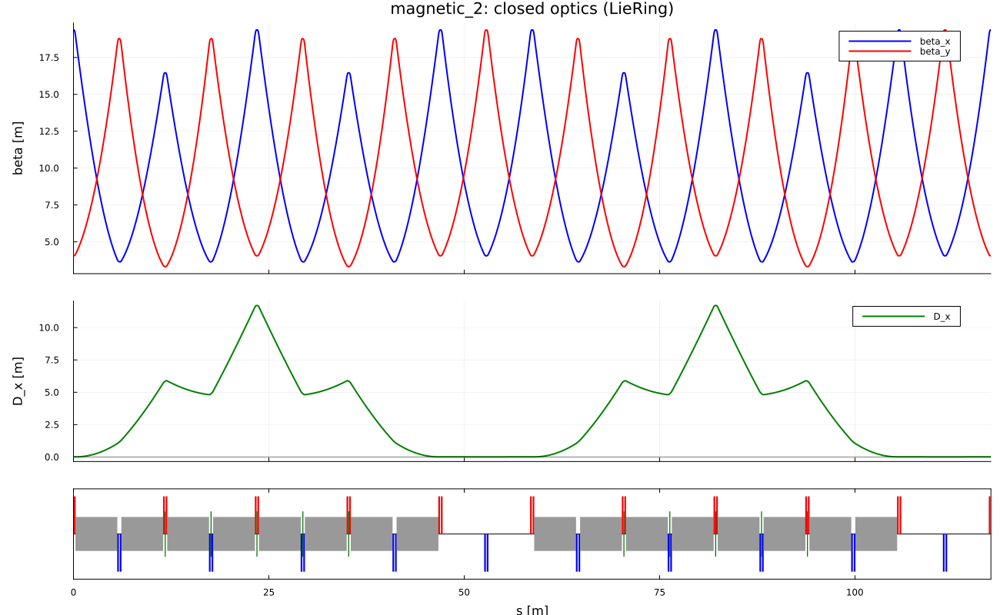

# Linear optics

The linear map of an element is the closed form of the quadratic Lie
transformation ``\exp(:f_2:)``. With
``\mathcal{H}_{ij}=\partial^2 H/\partial z_i\partial z_j|_0``,

```math
R=\exp(L\,S\,\mathcal{H}).
```

This is not a textbook transport matrix: the Hessian comes from the same
``H`` that generates the nonlinear factor. For plots along ``s`` the
matrices are multiplied element by element. For one-turn optics of the
ring, ``\mathtt{observables}`` reads the linear factor ``\mathcal{F}.R``
of the Lie product, not a second, independent matrix product.

With ``\cos\mu=\tfrac12\mathrm{Tr}M_x``,

```math
\beta=\frac{M_{12}}{\sin\mu},\qquad
\alpha=\frac{M_{11}-M_{22}}{2\sin\mu},
```

and the closed dispersion solves ``(I-M_4)D=M_{\cdot 6}``. Momentum compaction
to first order:

```math
\alpha_0=\frac{1}{\gamma_0^2}-\frac{(l|\delta)_{\mathrm{closed}}}{C}
=\frac1C\oint h\,D\,\mathrm{d}s.
```

Twiss and dispersion propagated in slices close after one turn to machine
precision.

