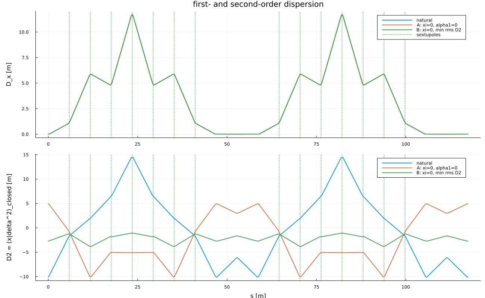

# Second-order dispersion and momentum compaction

The quadratic piece of the one-turn polynomial. A linear matrix cannot
see ``D_2`` or ``\eta_1``. Both are read from the same Lie product as
Twiss; they are not a second optical theory.

## Closed orbit in ``\delta``

```math
z_\perp(\delta)=D_1\delta+D_2\delta^2+O(\delta^3),
```

from ``M_\perp(z_\perp(\delta),\delta)=z_\perp(\delta)`` order by order.

## Path length and ``\alpha_i``

On the closed orbit the geometric circumference admits the expansion

```math
\frac{C(\delta)}{C_0}=1+\alpha_0\delta+\alpha_1\delta^2+\alpha_2\delta^3+\cdots.
```

With the canonical coordinate ``l`` related to time of flight by
``l=-v\Delta t``, one turn gives
``\Delta l=-C(\delta)+C_0\,v(\delta)/v_0``, hence

```math
\alpha_0=-\frac{l_1}{C}+\frac{1}{\gamma_0^2},\qquad
\alpha_1=-\frac{l_2}{C}+c_2,\qquad
\alpha_2=-\frac{l_3}{C}+c_3,
```

where ``v/v_0-1=c_1\delta+c_2\delta^2+c_3\delta^3`` and
``c_1=1/\gamma_0^2``. Equivalently, ``\alpha_i`` may be fitted from
``C(\delta)/C_0`` evaluated on closed orbits at several ``\delta``.

## Slip factor

The relative change of revolution period is the time of flight of one turn.
With ``l=-v\Delta t`` one has ``\Delta T/T_0=-(l/C)/(v/v_0)``, so on the
closed orbit

```math
\eta_0=-\frac{l_1}{C}=\alpha_0-\frac{1}{\gamma_0^2},\qquad
\eta_1=-\frac{l_2}{C}+\frac{l_1}{C}\,\frac{1}{\gamma_0^2}
=\alpha_1-\frac{\alpha_0}{\gamma_0^2}+\frac{3\beta_0^2}{2\gamma_0^2}+\frac{1}{\gamma_0^4}.
```

These are the coefficients used in the averaged longitudinal Hamiltonian
and in the formula for ``\delta_{\mathrm{eq}}``. They come from the
one-turn Lie product, expanded to a polynomial only to read ``l_1`` and
``l_2``.

