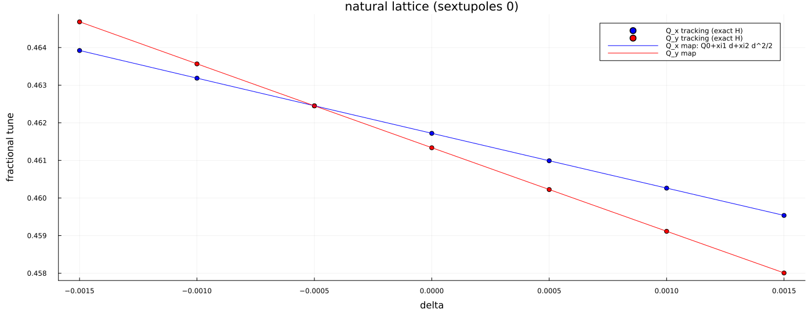

# Chromaticity

*`src/SecondOrder.jl` (`chromaticity_orders`), `src/TaylorMap.jl`
(`tunes_at_delta`), script `03_second_order.jl`.*

For fixed ``\delta`` the transverse motion around the closed orbit
``z_\perp(\delta)`` is linearised: the 4x4 Jacobian ``J(\delta)`` of the map at
the fixed point gives ``Q_{x,y}(\delta)`` from ``\cos 2\pi Q=\tfrac12\mathrm{Tr}J``.
Since ``\delta`` is a constant of motion without RF, the tunes are
invariants of motion and

```math
Q(\delta)=Q_0+\xi_1\delta+\tfrac12\xi_2\delta^2,\qquad \xi_1=\frac{dQ}{d\delta},\ \xi_2=\frac{d^2Q}{d\delta^2},
```

obtained by central differences with ``\Delta\delta=10^{-4}`` on the polynomial map.
Cross-check: tracking with the exact integrator at several ``\delta``, tune
from the least-squares fit ``x_{n+1}+x_{n-1}=2\cos(2\pi Q)x_n+b`` (insensitive to a
small fixed-point offset), then a parabola fit of ``Q(\delta)``.
Numbers: see the output of `03_second_order.jl` (reproduced in
[Sextupoles and the optional optimiser](sextupoles.md)).



| | map | tracking fit | COSY (reference only) |
|---|---|---|---|
| ``Q_{x0}`` (frac) | 0.46172014 | 0.46171903 | |
| ``\xi_{1x}`` | -1.461538 | -1.461531 | -1.840801 |
| ``\xi_{2x}`` | 8.5547 | 8.5546 | |
| ``Q_{y0}`` (frac) | 0.46133732 | 0.46133566 | |
| ``\xi_{1y}`` | -2.225488 | -2.225479 | -1.847679 |
| ``\xi_{2y}`` | 8.1041 | 8.1038 | |

The difference to COSY is open (its chromaticity convention was not verified).
