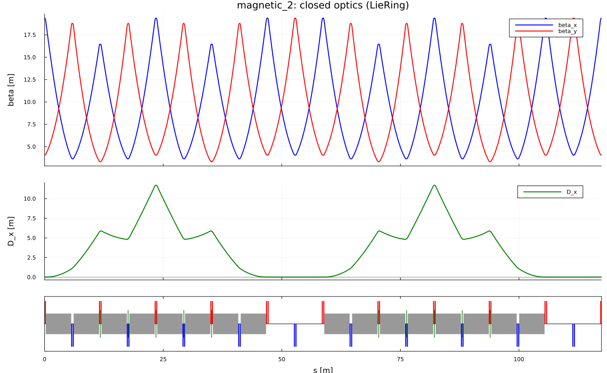

# Linear optics

*`src/LinearOptics.jl`, `src/OptiMParser.jl`, script `01_linear_optics.jl`.*

The linear map of each element is the Hessian of its Hamiltonian:
``R=\exp(L\,S\,\mathcal H)``, ``\mathcal H_{ij}=\partial^2H/\partial z_i\partial z_j|_0``.
The one-turn matrix ``M`` is the product over the lattice. With
``\cos\mu=\tfrac12\mathrm{Tr}\,M_{x}``, the closed Twiss functions are

```math
\beta=\frac{M_{12}}{\sin\mu},\quad \alpha=\frac{M_{11}-M_{22}}{2\sin\mu},
```

and the closed dispersion solves ``(I-M_4)D=M_{\cdot6}`` (4x4 transverse part,
``D=(D,D',D_y,D_y')``). The momentum compaction is

```math
\alpha_c=\frac{1}{\gamma_0^2}-\frac{(l|\delta)_{\rm closed}}{C},
```

cross-checked by ``\alpha_c=\frac1C\oint hD\,ds``. Twiss and dispersion are
propagated in slices along the ring ("closed" check: after one turn they
reproduce the start to ``10^{-13}``).

| quantity | LieRing | reference | source |
|---|---|---|---|
| C [m] | 117.388296 | | |
| ``\beta_x(0)`` [m] | 19.367522 | 19.3675 | OptiM |
| ``\beta_y(0)`` [m] | 4.054470 | 4.05447 | OptiM |
| ``\alpha_x(0)`` | -2.5191e-4 | -2.51909e-4 | OptiM |
| ``D'(0)`` | -5.0616e-4 | -5.0616e-4 | OptiM |
| ``D(0)`` [m] | 0.011094 | 0 | OptiM (see Assumptions) |
| ``Q_x`` | 2.461720 | frac 0.446284 | COSY |
| ``Q_y`` | 2.461337 | frac 0.476682 | COSY |
| ``\alpha_c`` | 0.23047028 | 0.23036260 | COSY |



The tunes differ from COSY by 0.015 in both planes, with opposite signs. The
reason is open (fringe-field or element-model treatment in the COSY deck is the
main suspect); the OptiM initial Twiss agree to 5 digits.

