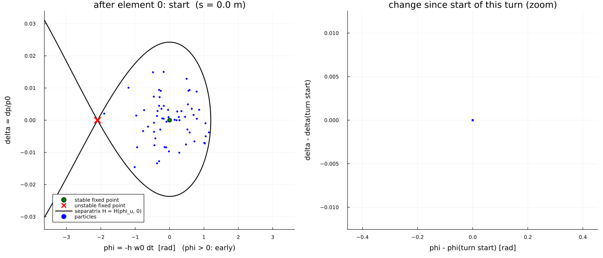

# Longitudinal motion from the ring average

## From the 6D Hamiltonian to a 2D synchrotron Hamiltonian

Over one turn the magnetic lattice advances ``(l,\delta)`` through the exact
element Hamiltonians (or, equivalently, through the BLonD `exact` drift built
from ``\alpha_{0,1,2}``). The RF cavity changes ``\delta`` at essentially fixed
``l``. Coarse-graining to one map per turn in the variables
``(\phi,\delta)`` with ``\phi=-h\omega_0\Delta t`` gives

```math
\begin{aligned}
\phi_{n+1}&=\phi_n-2\pi h\bigl(\eta_0\delta_{n+1}+\eta_1\delta_{n+1}^2+\cdots\bigr),\\
\delta_{n+1}&=\delta_n+A\bigl(\sin(\phi_s+\phi_n)-\sin\phi_s\bigr),\qquad
A=\frac{ZVT}{\beta_0^2 E_0}.
\end{aligned}
```

Treating the turn number as continuous yields the smooth Hamiltonian

```math
H(\phi,\delta)=-2\pi h\Bigl(\frac{\eta_0\delta^2}{2}+\frac{\eta_1\delta^3}{3}\Bigr)
+A\bigl(\cos(\phi_s+\phi)+\phi\sin\phi_s\bigr),
```

which is the average of the full 6D dynamics over one revolution under the
assumptions of a single RF station, no transverse–longitudinal coupling in the
averaged equations, and ``\delta`` small enough that the closed-orbit expansion
of the path length converges. Fixed points on ``\delta=0``: stable ``\phi=0``,
unstable ``\phi_u=\pi-2\phi_s``. The **separatrix** is the level set
``H=H(\phi_u,0)``; the RF bucket is the region around the origin inside it.
Stability requires ``\eta_0\cos\phi_s>0``.

Small-amplitude synchrotron tune:

```math
Q_s=\sqrt{\frac{h\,\eta_0\,ZVT\cos\phi_s}{2\pi\beta_0^2 E_0}}
\qquad\text{(smooth)},\qquad
\cos(2\pi Q_s^{\mathrm{kick}})=1-\tfrac12(2\pi Q_s)^2
\qquad\text{(one kick/turn)}.
```

## Element-by-element view of one turn

Left: absolute ``(\phi,\delta)`` with the analytic separatrix. Right: change
relative to the turn start, with fixed axes set by lattice/RF scales —

- horizontal: ``\pm 1.5\,|2\pi h\eta_0|\,\delta_{\mathrm{ens}}`` (full-turn
  phase-slip scale for the largest ``|\delta|`` in the ensemble);
- vertical: ``\pm 1.5\,A`` (RF kick amplitude).

Only the cavity changes ``\delta`` within a turn; ``\phi`` changes continuously
through path length and velocity.


