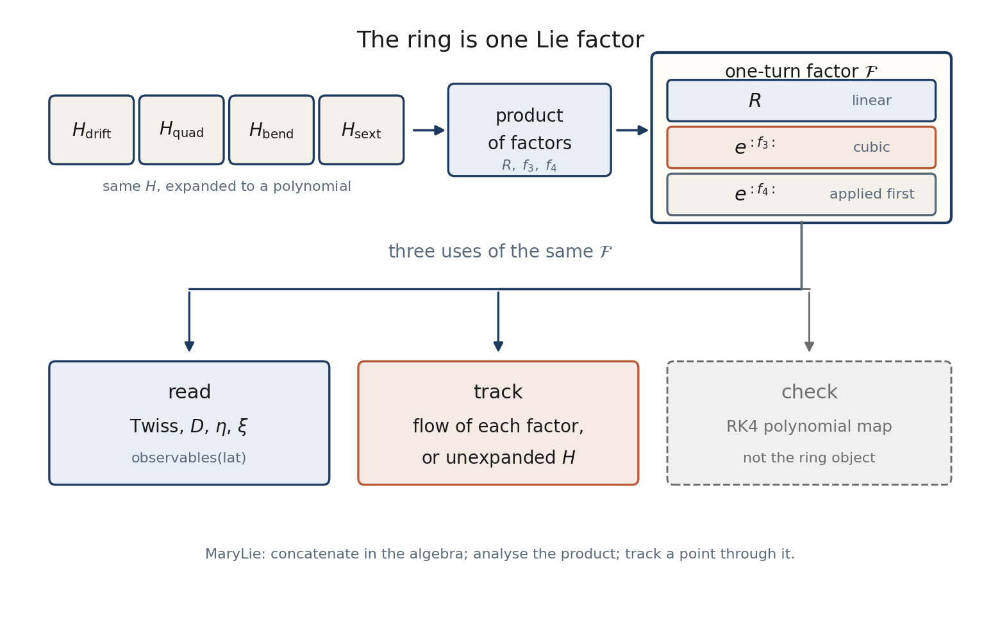

# Programmer Manual

Physics is in the [Beam Physics Manual](../index.md). This page lists
entry points of the Julia package.

The object of the ring is the Lie product of Dragt–Finn factors. That is
the same cut as MaryLie: concatenate in the algebra, analyse the product,
track a point through it. Linear optics is the closed form of
``\exp(:f_2:)``, stored as the matrix ``R``. It is not a second theory of
the lattice.



`observables(lat)` builds `ring_lie_factor` once and reads Twiss,
``\eta`` and ``\xi`` from that factor. `ring_taylor_map` is an RK4
polynomial and is not that object. `ring_matrix` remains a fast
order-1 builder for plots along ``s``.


## Layout

| path | role |
|---|---|
| `src/Constants.jl` | CODATA deuteron, reference particle, ``v(\delta)``, ``e(\delta)``, ``z\leftrightarrow u`` |
| `src/Jets.jl` | polynomial space, degree 4 in Hamiltonians, degree 3 in maps |
| `src/Elements.jl` | element types and lattice |
| `src/Hamiltonians.jl` | element generator ``H`` as a polynomial |
| `src/LieOperators.jl` | Poisson bracket, Lie series, Dragt–Finn, product of factors to degree 4 |
| `src/OptiMParser.jl` | `.opt` reader (mass from the particle, not the file header) |
| `src/LinearOptics.jl` | ``R=\exp(L S \mathrm{Hess}\,H)``, slice Twiss along ``s`` |
| `src/Symplectic.jl` | ``J^\mathsf{T}SJ-S`` |
| `src/Tracking.jl` | flow of each factor, thin RF kick, product of the ring |
| `src/MapAnalysis.jl` | closed orbit, ``D_2``, ``\eta``, chromaticity, `observables` |
| `src/TaylorMap.jl` | independent DA map (RK4 in polynomials) — a check |
| `src/NormalForm.jl` | one-turn factor with thin RF; homological operator on generators; torus average of ``\delta`` |
| `src/SecondOrder.jl` | averaged longitudinal Hamiltonian, BLonD ``(dt,dE)`` bridge |
| `src/ExactIntegrator.jl` | unexpanded ``H``, finite cavity, renormalise |
| `src/Acceleration.jl` | ramp, tune fit |
| `src/Plotting.jl` | figures |
| `src/Optimizers.jl` | optional sextupole response |

Entry: `include("src/LieRing.jl"); using .LieRing`.

The one-turn object used for the normal form is `one_turn_factor_rf`, the
product of `ring_lie_factor` with the thin-kick factor. Optics of the
magnetic product without RF is `observables(lat)`. `ring_taylor_map`
composes truncated polynomials and is not that object.

## Scripts

```
julia --project=. scripts/01_linear_optics.jl
julia --project=. scripts/02_lie_maps.jl
julia --project=. scripts/03_second_order.jl
julia --project=. scripts/04_optional_sextupole_optimization.jl
julia --project=. scripts/05_rf_acceleration.jl
julia --project=. scripts/06_coordinates.jl
julia --project=. scripts/07_blond_longitudinal.jl   # external drift formulae, not used in the ring product
julia --project=. scripts/08_lie_product.jl          # BCH product of two factors
julia --project=. scripts/09_lie_normal_form.jl      # one-turn factor and torus average
```

The equilibrium-momentum study lives in `C:\GIT_REPOS\SCT_2\Julia\equilibrium_energy`
(`scripts/run_v08.jl` and the research note). It depends on this package
via `Pkg.develop`.

## Accepted design choices

- Injection kinetic energy 10 MeV; final 270 MeV from the lattice header.
- Stationary study: thin RF, ``V=0.2`` MV, ``h=5``, ``\varphi_s=\pi``.
- Ramp demo: finite cavity ``L=1`` m, ``\varphi_s=150^\circ``.
- Mass = CODATA deuteron ``1875.61294257`` MeV (OptiM `Mass=2*938.272` ignored).
- Lattice sequence used once (file `Number of periods=2` is an error; bend is 360 deg).
- Closed ``D(0)=0.011`` m (OptiM initial 0 is not the closed solution).
- Default sextupole strengths are zero.

## Docs build

```
julia --project=docs docs/make.jl
julia docs/make_pdf.jl
julia docs/make_pdf_programmer.jl
```
