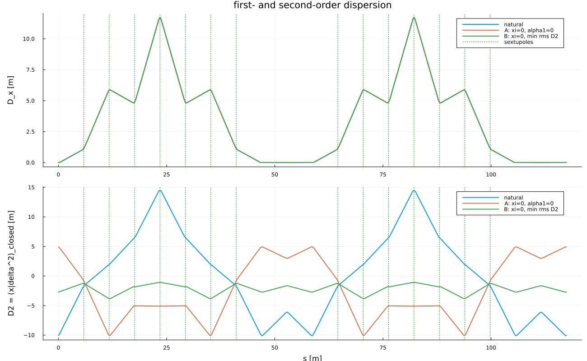

# Second-order dispersion, momentum compaction and slip factor

*`src/SecondOrder.jl`, `src/TaylorMap.jl`, script `03_second_order.jl`.*

The one-turn Taylor map ``M`` (order 3, RF off) gives the closed orbit as a
polynomial in ``\delta``:

```math
z_\perp(\delta)=D_1\delta+D_2\delta^2+O(\delta^3),\qquad D_1=(D,D'),\ D_2=(D_2,D_2'),
```

from the fixed-point condition ``M_\perp(z_\perp(\delta),\delta)=z_\perp(\delta)``
order by order: ``(I-R)D_1=R_{\cdot6}``, ``(I-R)D_2=Q(D_1\delta+\delta e_6)|_{\delta^2}``.
``D_2`` is propagated around the ring by pushing the polynomial orbit through
each element map (`dispersion_along`).

The path-length change per turn on the closed orbit is
``\Delta l(\delta)=l_1\delta+l_2\delta^2`` (``l`` component of the map evaluated
on ``z_\perp(\delta)``). With the velocity expansion
``\frac{v_0}{v(\delta)}=1-c_1\delta-c_2\delta^2+\dots`` (``c_1=1/\gamma_0^2``):

```math
\alpha_c(\delta)=\alpha_0+\alpha_1\delta,\quad \alpha_0=-\frac{l_1}{C}+c_1,\quad \alpha_1=-\frac{l_2}{C}+c_2,
```

```math
\eta(\delta)=\eta_0+\eta_1\delta,\quad \eta_0=\alpha_0-\frac{1}{\gamma_0^2},\quad
\eta_1=\alpha_1-\alpha_0c_1-c_2+c_1^2 .
```

``\eta`` is the relative change of the revolution time, ``\Delta T/T=\eta_0\delta+\eta_1\delta^2``,
and enters the phase equation ``\Delta\phi/\text{turn}=-2\pi h(\eta_0\delta+\eta_1\delta^2)``.

Results (natural lattice, sextupoles 0), from `05_rf_acceleration.jl`
section 4 and `03_second_order.jl`:

| quantity | 10 MeV | 270 MeV |
|---|---|---|
| ``\alpha_0`` | 0.23047028 | 0.23047028 |
| ``\alpha_1`` | 0.33900771 | 0.33900771 |
| ``\eta_0`` | -0.75895642 | -0.53378406 |
| ``\eta_1`` | 1.10563172 | 1.01720896 |

``\alpha_0,\alpha_1`` are purely geometric (magnet strengths scale with ``p_0``);
the energy dependence of ``\eta`` comes only from ``c_1,c_2``.



Second-order dispersion at ``s=0`` (`03_second_order.jl`): ``D=0.01109398`` m,
``D'=-5.0616\times10^{-4}``, ``D_2=-10.054932`` m, ``D_2'=0.459066``; along the ring
``D_2\in[-10.08,\,14.41]`` m; closure ``D_2(C)-D_2(0)=-3.7\times10^{-14}``.
Exact-tracking cross-check (closed orbit at fixed ``\delta``, cubic fit):
``x_{co}=0.01108483\,\delta-10.054867\,\delta^2``, ``\Delta C/C=0.23047050\,\delta+0.339007\,\delta^2``.
Here ``\alpha_1`` is defined by ``\Delta C/C=\alpha_0\delta+\alpha_1\delta^2``
(the local derivative is ``\alpha_0+2\alpha_1\delta``).

