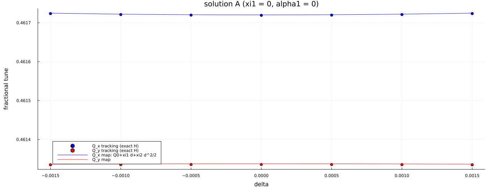

# Sextupoles and the optional optimiser

*Placement (lattice editing, no physics): `src/Elements.jl`
(`find_optics_maxima`, `place_sextupole_families`, `set_family_strengths`).
Optimisation: `src/Optimizers.jl`, called **only** by
`scripts/04_optional_sextupole_optimization.jl`.*

**Default: all sextupoles have the strength given in the lattice file, which is
zero for `magnetic_2.opt`. No script except 04 changes them.**

## Placement

Three families of 0.12 m sextupoles are placed into the nearest existing
sextupole slot or short drift next to local maxima (``\ge0.8`` of the global
maximum) of ``D_x`` (family SXD, 2 magnets), ``\beta_x`` (SXB, 4) and ``\beta_y``
(SYB, 8). A sextupole acts chromatically through ``x=D\delta``: the
first-order chromaticity contribution is
``\Delta\xi_{x,y}=\pm\frac{1}{4\pi}\sum k_2L\,\beta_{x,y}D``, so SXD/SXB act mostly
on ``\xi_x`` and SYB on ``\xi_y``; ``D_2`` and ``\alpha_1`` are driven by ``k_2LD^2``.
The circumference is unchanged.

## Response (per unit ``k_2=1`` m``^{-3}`` for the whole family)

| family | ``\Delta\xi_{1x}`` | ``\Delta\xi_{1y}`` | ``\Delta\alpha_1`` | ``\Delta D_2(0)`` [m] |
|---|---|---|---|---|
| SXD | 4.32833 | -0.90618 | -1.63792 | 89.86 |
| SXB | 3.67887 | -0.74301 | -0.40970 | -0.034 |
| SYB | 0.84330 | -4.33701 | -0.24240 | 9.455 |

``\Delta\eta_1=\Delta\alpha_1`` (sextupoles do not change ``c_1,c_2``).

## Optional example solutions

These targets are *examples*, not requirements: **A**
``\xi_{1x}=\xi_{1y}=\alpha_1=0``; **B** ``\xi_{1x}=\xi_{1y}=0`` and minimum rms
``D_2`` (least squares).

| quantity | natural | A | B |
|---|---|---|---|
| ``k_2`` SXD / SXB / SYB [m``^{-3}``] | 0 / 0 / 0 | 0.2304 / 0.2653 / -0.6067 | 0.1456 / 0.3650 / -0.6061 |
| ``\xi_{1x}`` | -1.4615 | 0.0000 | 0.0000 |
| ``\xi_{1y}`` | -2.2255 | 0.0000 | 0.0000 |
| ``\xi_{2x}`` | 8.555 | 3.934 | 5.165 |
| ``\xi_{2y}`` | 8.104 | -0.717 | 1.236 |
| ``D_2(0)`` [m] | -10.055 | 4.905 | -2.718 |
| max ``\vert D_2\vert `` [m] | 14.41 | 10.04 | 3.81 |
| rms ``D_2`` [m] | 7.558 | 5.728 | 2.411 |
| ``\alpha_1`` | 0.33901 | 0.00000 | 0.09799 |
| ``\eta_1`` (270 MeV) | 1.01721 | 0.67820 | 0.77619 |

Tracking check of A: ``\xi_{1x}=0.00001``, ``\xi_{2x}=3.934``, ``\xi_{1y}=0.00000``,
``\xi_{2y}=-0.717`` (map: identical to 3 digits).

