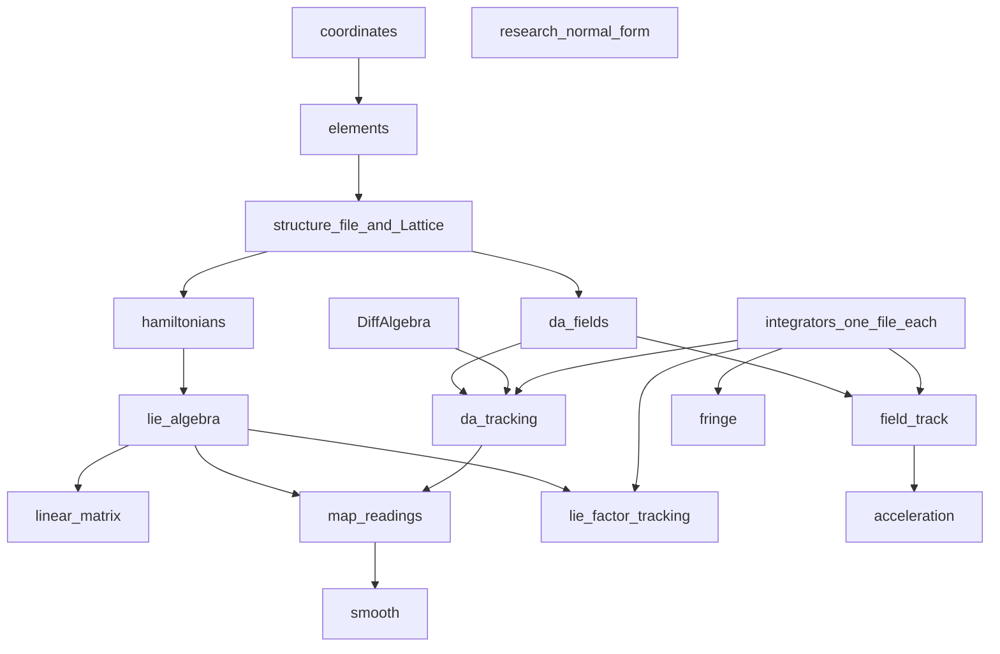

# Bell architecture

**Author:** Kolokolchikov Sergey Dmitrievich  
**Email:** sergey.bell13@gmail.com

Bell is a Julia program for symplectic modelling of a magnetic ring. Two
independent physics stacks share elements, coordinates and ODE integrators.
They do not call each other; comparison is done from the outside.

## Blocks

| File | Block | Role |
|------|--------|------|
| `src/core/coordinates.jl` | Coordinates | Particle, reference, canonical and laboratory coordinates |
| `src/core/elements.jl` | Elements | Data types: drift, bend, quad, sext, thin RF, marker |
| `src/core/structure.jl` | Structure | Lattice and structure file |
| `src/physics/hamiltonians.jl` | Hamiltonians | Polynomial `H` for the Lie path only |
| `src/physics/fields.jl` | Fields | Equations of motion `dz/ds` from multipole fields |
| `src/maps/lie/lie_algebra.jl` | Lie algebra | Poisson bracket, Lie series, Dragt–Finn |
| `src/maps/lie/tracking.jl` | Tracking | Lie factors of truncated `H`; thin RF via `rf_kick` |
| `src/maps/da/field_track.jl` | FieldTrack | Float64 tracking of field ODEs + `rf_kick` |
| `src/maps/da/tracking.jl` | DATracking | Same field ODEs on DA (any order N) |
| `src/math/DiffAlgebra.jl` | DiffAlgebra | Truncated power series (pure maths) |
| `src/longitudinal_models/smooth.jl` | Smooth | Averaged `(φ, δ)` — not 6D RF |
| `src/longitudinal_models/acceleration.jl` | Acceleration | Ramp with thin `RFCavity` + `renormalize` |

## Two stacks

**Lie path.** Polynomial Hamiltonian → Dragt–Finn → `Tracking`.

**Field / DA path.** Write `dz/ds = f(z)` from hard-edge fields
(`physics/fields.jl`), not from `H`. Evaluate on `Float64` (`FieldTrack`) or on DA
(`DATracking`) to any order `N`. Same thin `rf_kick`.

## Thin RF in 6D

Only zero-length [`RFCavity`](@ref) and [`rf_kick`](@ref). On a ramp,
[`renormalize`](@ref) updates `p0` after the kick of the synchronous particle.

## Smooth model

`smooth.jl` does not track the ring in 6D. Acceleration does not use it.
