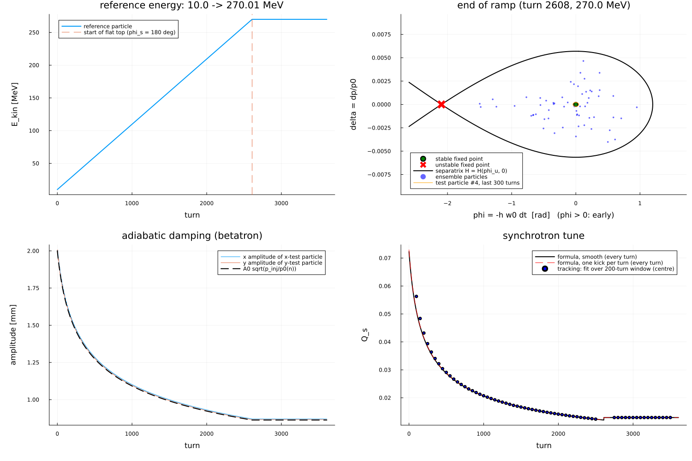

# Acceleration and adiabatic damping

A storage ring with ``\sin\varphi_s=0``, or with ``ZV\sin\varphi_s`` cancelling a constant loss, keeps ``p_0`` fixed. The one-turn map is the same symplectic map every turn.

## Moving reference

If ``\sin\varphi_s\neq 0``, the uniform-gap Hamiltonian contains a term linear in the time coordinate. The origin ``l=\delta=0`` is no longer a solution. The natural coordinates follow a reference momentum ``p_0(s)`` with

```math
\frac{\mathrm{d}p_0}{\mathrm{d}s}=\frac{ZV\sin\varphi_s}{v_0 L},
```

so the synchronous particle stays the reference. Passing to variables normalised by this ``p_0(s)`` adds

```math
\Delta H=\frac{p_0'}{p_0}\Big[x\,p_x+y\,p_y+l\,(1+\delta)\Big]
```

to ``H``. On axis at ``\delta=0`` the linear RF term and ``-\partial(\Delta H)/\partial l`` cancel, and ``l=\delta=0`` is a solution again. ``\beta_0``, ``\gamma_0`` and ``k=2\pi h\beta_0/C`` become functions of ``s``.

In the tracker the same idea is applied once per passage through a thin cavity. After the kick, the synchronous particle is declared the new reference (`renormalize`): positions are unchanged, the time lag is counted from the synchronous particle, and

```math
p_0'=p_0(1+\delta_s),\qquad
1+\delta'=\frac{1+\delta}{1+\delta_s},\qquad
p_x'=\frac{p_x}{1+\delta_s},\qquad
p_y'=\frac{p_y}{1+\delta_s}.
```

Magnets are assumed to ramp with ``p_0`` (normalised strengths fixed). The RF frequency follows ``h\omega_0(p_0)``.

## Where symplecticity is lost

While ``p_0`` is fixed, the kick is symplectic in ``z``. During acceleration the Hamiltonian depends on ``s`` through ``p_0(s)`` and the system is not autonomous: each turn has its own map ``\mathcal{M}_n``. The flow is still Hamiltonian, so each ``\mathcal{M}_n`` is symplectic in dimensioned, un-normalised variables.

The replacement of the reference is not a symplectic map in the normalised coordinates. Arrival time and the positions are unchanged:

```math
\begin{aligned}
l_{\mathrm{new}}&=l_{\mathrm{old}},\\
1+\delta_{\mathrm{new}}&=(1+\delta_{\mathrm{old}})\frac{p_{0,\mathrm{old}}}{p_{0,\mathrm{new}}},\\
p_{x,y,\mathrm{new}}&=p_{x,y,\mathrm{old}}\frac{p_{0,\mathrm{old}}}{p_{0,\mathrm{new}}}.
\end{aligned}
```

The determinant in each plane is ``p_{0,\mathrm{old}}/p_{0,\mathrm{new}}<1`` (and the product of the three planes is the cube of that factor). Phase-space volume in the normalised variables shrinks. That shrinkage is adiabatic damping: the dimensioned ``P_x=p_0 p_x`` is what a longitudinal field leaves invariant, so ``p_x\propto 1/p_0``.

The Courant–Snyder action in normalised variables then scales as ``J\propto 1/p_0``, and betatron amplitudes damp as

```math
\frac{A(n)}{A(0)}=\sqrt{\frac{p_{\mathrm{inj}}}{p_0(n)}}.
```

## Adiabatic reading

If ``p_0`` changes slowly against the synchrotron period,

```math
\frac{1}{\gamma_0}\frac{\mathrm{d}\gamma_0}{\mathrm{d}t}\ll Q_s\omega_0,
```

the turn map may be frozen: at each ``p_0`` one builds an autonomous ``\mathcal{M}(p_0)``, reads the closed orbit, the tunes and the bucket, then moves ``p_0`` slowly. Actions are adiabatic invariants and the normalised amplitudes fall as a power of ``p_0``. The reading fails where the parameters move fast compared with the proper frequency: near transition, where ``Q_s\to 0``, and on a fast resonance crossing.


