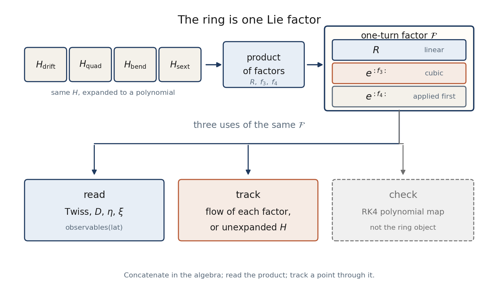

# Beam Physics Manual

**BELL — Beam Evolution in Accelerator Lattice**

**Author:** Kolokolchikov Sergey Dmitrievich (`sergey.bell13@gmail.com`)

Symplectic modelling of a charged particle in a magnetic lattice with an RF cavity.
The independent variable is the arc length ``s`` along the reference orbit.
The model of an element is its s-Hamiltonian ``H``. The equations
``\mathrm{d}z/\mathrm{d}s = S\nabla H`` and the maps of the element are derived from ``H``.
Laboratory angles and the RF phase are output, not the phase-space coordinates.

The object read by the optics is a product of Lie transformations. Each magnet,
and a thick cavity, has one ``H``. On the Lie path that ``H`` becomes a
Dragt–Finn factor ``R\circ e^{:f_3:}\circ e^{:f_4:}``. Concatenation in the
algebra produces the one-turn factor ``\mathcal{F}``. Twiss parameters, slip,
chromaticity and the normal form are readings of ``\mathcal{F}``. A point can
be tracked by the exact flow of those factors, or by integrating the
unexpanded ``H``. A truncated Taylor map is a check. It does not define the ring.

Linear optics, second-order slip and chromaticity are homogeneous pieces of
the same polynomial, not separate theories.

This manual is the physics. The same chapter list exists in Russian under
`docs/manual/ru/`. Figures are shared in `docs/manual/assets/`. How each
route is wired in the source tree is in [Computation paths](computation_paths.md).
The programmer manual stays in `docs/manual/programmer/`.

Contents:

1. [Coordinates, units, reference particle](coordinates.md)
2. [The s-Hamiltonian](hamiltonian_s.md)
3. [Element Hamiltonians](hamiltonians.md)
4. [Fringe fields](fringe.md)
5. [Linear optics](linear.md)
6. [Lie product of the ring](lie.md)
7. [Readings of the one-turn map](map_readings.md)
8. [Normal form and the equilibrium momentum](normal_form.md)
9. [RF motion](rf.md)
10. [Acceleration and adiabatic damping](acceleration.md)
11. [Longitudinal motion from the ring average](longitudinal.md)
12. [Sextupole families](sextupoles.md)
13. [Lie factors and differential algebra](lie_and_da.md)
14. [Computation paths](computation_paths.md)
15. [Spin](spin.md)
16. [Assumptions](assumptions.md)

Figures use the Nuclotron-based lattice at deuteron kinetic energy 270 MeV
unless a ramp from 10 MeV is shown.
