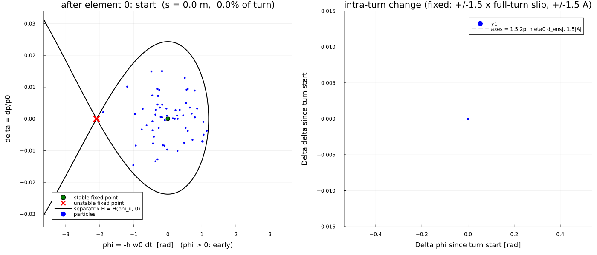

# Longitudinal motion from the ring average

The six-dimensional ``H`` advances ``(l,\delta)`` element by element. The slip coefficients ``\eta_0`` and ``\eta_1`` are those of the time of flight, read in [Readings of the one-turn map](map_readings.md). A thin RF kick changes ``\delta`` at fixed arrival time. Coarse-graining to one map per turn in ``(\varphi,\delta)``, with ``\varphi=-h\omega_0\Delta t``, gives

```math
\begin{aligned}
\varphi_{n+1}&=\varphi_n-2\pi h\bigl(\eta_0\delta_{n+1}+\eta_1\delta_{n+1}^2+\cdots\bigr),\\
\delta_{n+1}&=\delta_n+A\bigl(\sin(\varphi_s+\varphi_n)-\sin\varphi_s\bigr),
\qquad
A=\frac{ZV}{\beta_0^2 E_0}.
\end{aligned}
```

``\eta_0`` is the linear slip. ``\eta_1`` is the quadratic slip. This is an average: one RF station, no transverse–longitudinal coupling kept in the averaged equations, and ``\delta`` small enough that the closed-orbit expansion of the path length converges. It does not integrate the lattice.

Treating the turn number as continuous yields the smooth Hamiltonian

```math
\bar H(\varphi,\delta)
=-2\pi h\Bigl(\frac{\eta_0\delta^2}{2}+\frac{\eta_1\delta^3}{3}\Bigr)
+A\bigl(\cos(\varphi_s+\varphi)+\varphi\sin\varphi_s\bigr).
```

The bar marks the average over one revolution. ``\bar H`` is not the s-Hamiltonian of an element. Fixed points on ``\delta=0``: stable ``\varphi=0``, unstable ``\varphi_u=\pi-2\varphi_s``. The separatrix is the level set ``\bar H=\bar H(\varphi_u,0)``. The bucket is the region around the origin inside it. Stability requires ``\eta_0\cos\varphi_s>0``.

Small-amplitude synchrotron tune, smooth and one-kick-per-turn:

```math
Q_s=\sqrt{\frac{h\,\eta_0\,ZV\cos\varphi_s}{2\pi\beta_0^2 E_0}},
\qquad
\cos(2\pi Q_s^{\mathrm{kick}})=1-\tfrac12(2\pi Q_s)^2.
```

The square root is the same reading as in [RF motion](rf.md).

## What ``\eta_1`` does to the bucket

With only ``\eta_0`` the portrait is a pendulum. The separatrix is symmetric under ``\delta\to-\delta``. At ``\sin\varphi_s=0`` the half-height is ``\delta_{\max}=\sqrt{2A/(\pi h|\eta_0|)}`` in the normalisation of ``\bar H`` above (the numerical factor follows from ``A`` and from ``\mathrm{d}\varphi/\mathrm{d}t=-h\omega_0\eta_0\delta``).

With ``\eta_1``, ``\mathrm{d}\varphi/\mathrm{d}t=0`` also at ``\delta_*=-\eta_0/\eta_1``. A second chain of fixed points appears. The effective slip ``\partial(\eta_0\delta+\eta_1\delta^2)/\partial\delta`` has the opposite sign there, so a point that is stable at ``\delta=0`` is unstable at ``\delta_*``, and conversely. The cubic term makes the separatrix asymmetric. While ``|\delta_*|\gg\delta_{\max}`` the correction is of order ``\eta_1\delta_{\max}/\eta_0``.

Near transition ``\eta_0\to 0``, so ``Q_s\to 0`` and the adiabatic reading of [Acceleration](acceleration.md) fails. ``\delta_{\max}`` grows, ``\delta_*`` falls into the bucket, and the nonlinear slip dominates. At ``\eta_0=0`` there is no linear longitudinal focusing.

## One turn, element by element

Left: absolute ``(\varphi,\delta)`` with the analytic separatrix. Right: the change relative to the turn start, on axes fixed by the lattice and the RF voltage. Only the cavity changes ``\delta`` within a turn. ``\varphi`` changes along the whole ring through path length and velocity.



