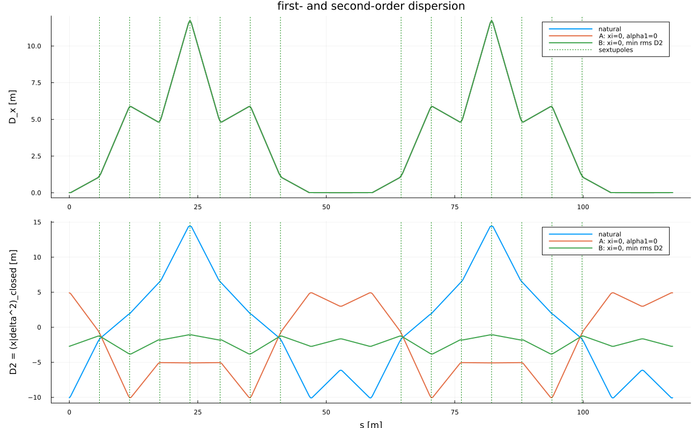
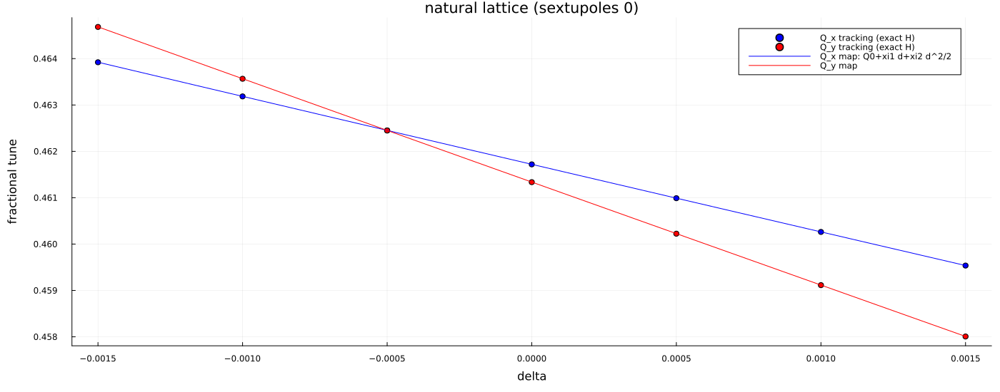

# Readings of the one-turn map

Twiss parameters, dispersion, momentum compaction, the slip factor and chromaticity are readings of one polynomial. A linear matrix cannot see ``D_2`` or ``\eta_1``. Chromaticity is not derived from the Twiss functions. The Lie product is expanded only far enough to read a coefficient. Building the map is not part of the reading.

## Closed orbit in ``\delta``

Without RF, ``\delta`` is constant. The transverse closed orbit admits

```math
z_\perp(\delta)=D_1\delta+D_2\delta^2+O(\delta^3),
```

from ``M_\perp(z_\perp(\delta),\delta)=z_\perp(\delta)`` order by order. ``D_1`` is the ordinary dispersion. ``D_2`` is the second-order dispersion.

## Path length and momentum compaction

On that orbit the geometric circumference is

```math
\frac{C(\delta)}{C_0}=1+\alpha_0\delta+\alpha_1\delta^2+\alpha_2\delta^3+\cdots.
```

With ``l=-v\Delta t``, one turn gives ``\Delta l=-C(\delta)+C_0\,v(\delta)/v_0``, hence

```math
\alpha_0=-\frac{l_1}{C}+\frac{1}{\gamma_0^2},\qquad
\alpha_1=-\frac{l_2}{C}+c_2,\qquad
\alpha_2=-\frac{l_3}{C}+c_3,
```

where ``v/v_0-1=c_1\delta+c_2\delta^2+c_3\delta^3`` and ``c_1=1/\gamma_0^2``. Equivalently, the ``\alpha_i`` may be fitted from ``C(\delta)/C_0`` on closed orbits at several ``\delta``. To first order the same compaction is the integral of curvature against dispersion,

```math
\alpha_0=\frac{1}{C}\oint h\,D\,\mathrm{d}s.
```

## Slip factor

The relative change of the revolution period is the time of flight of one turn. With ``l=-v\Delta t`` one has ``\Delta T/T_0=-(l/C)/(v/v_0)``, so on the closed orbit

```math
\eta_0=-\frac{l_1}{C}=\alpha_0-\frac{1}{\gamma_0^2},
```

```math
\eta_1=-\frac{l_2}{C}+\frac{l_1}{C}\,\frac{1}{\gamma_0^2}
=\alpha_1-\frac{\alpha_0}{\gamma_0^2}+\frac{3\beta_0^2}{2\gamma_0^2}+\frac{1}{\gamma_0^4}.
```

``\eta_0`` is the linear slip. ``\eta_1`` is the quadratic slip. These are the coefficients of the averaged longitudinal Hamiltonian. They come from the one-turn factor, expanded to a polynomial only to read ``l_1`` and ``l_2``.

Two effects produce them. The path lengthens because the dispersive orbit samples the bends, ``C/C_0=1+\alpha_0\delta+\alpha_1\delta^2+\cdots``. The speed changes,

```math
\frac{\beta_0}{\beta}=1-\frac{\delta}{\gamma_0^2}+\Big(1+\frac{\beta_0^2}{2}\Big)\frac{\delta^2}{\gamma_0^2}+\cdots.
```

The product is ``T/T_0-1=\eta_0\delta+\eta_1\delta^2+\cdots``. Above transition ``\eta_0>0``. At ``\gamma_0\to\infty``, ``\eta_1\to\alpha_1``.



## Chromaticity

At fixed ``\delta`` the transverse motion about ``z_\perp(\delta)`` is linearised. The tunes from ``\cos 2\pi Q=\tfrac12\mathrm{Tr}\,J(\delta)`` expand as

```math
Q(\delta)=Q_0+\xi_1\delta+\tfrac12\xi_2\delta^2.
```

Since ``\delta`` is conserved without RF, these are invariants of the one-turn map. The degree-3 piece of the polynomial is what a ``6\times 6`` matrix cannot see. A cross-check integrates the unexpanded Hamiltonians at several ``\delta`` and fits the tune of a small betatron oscillation.



## What is not a reading

Propagating Twiss and dispersion slice by slice is the same linear matrix product written along ``s``. It closes after one turn to machine precision, and it is still degree 1. The second-order dispersion, ``\eta_1`` and ``\xi_1`` are read from the higher homogeneous pieces, or from a differential-algebra map of ``H``, not from a second optical theory.
