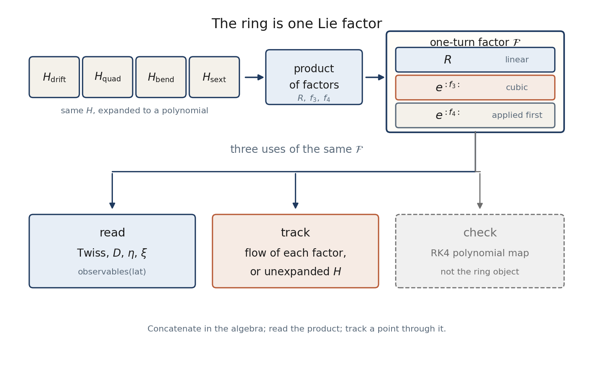

# Programmer Manual

Physics is in the [Beam Physics Manual](../en/index.md)
(Russian: [руководство](../ru/index.md)). The present computation routes are
in [Computation paths](../en/computation_paths.md). This page is the map of
the Julia package: which file owns which step, and which example runs it.

The ring used for optics is the Lie product of Dragt–Finn factors.
[`observables`](@ref) builds that product on [`magnetic_lattice`](@ref) (a thin
cavity is dropped, a thick cavity becomes a drift of the same length) and
reads Twiss, ``\eta``, and ``\xi`` from the factor. [`ring_taylor_map`](@ref)
is a separate Taylor integration of the same Hamiltonian (default RK4 through
[`element_flow`](@ref)). It is not that product. A Taylor map is symplectic
only up to its truncation. A Lie factor applied by its flow stays symplectic
at any truncation; the factors in the tree carry generators ``f_3`` and ``f_4``.




`using Bell` loads the facade. `NormalForm` is research and stays out of that
list: `using Bell.NormalForm`. `DiffAlgebra` and `Integrators` are the same:
`using Bell.DiffAlgebra`, `using Bell.Integrators`.

## Layers

`src/Bell.jl` includes files along this chain. `Hamiltonians` stays after
`LieAlgebra` (the Taylor entry of `hamiltonian` uses `Z`). `FringeMaps` stays
after `MapReadings` (`fringe_observables` reads a map that is already built).
`NormalForm` is included last.

```
math → core → io → physics → maps → analysis → tracking → longitudinal_models → optimizers → research
```

| layer | path | what you call |
|:--|:--|:--|
| math | `src/math/DiffAlgebra.jl`, `src/math/dual.jl`, `src/math/integrators/` | truncated series, `Dual` / `deriv`, ODE methods. No elements. |
| core | `src/core/coordinates.jl`, `elements.jl`, `structure.jl`, `symplectic.jl` | `RefParticle`, element data, `Lattice`, `path_length`, `symplectic_error` |
| io | `src/io/optim_converter.jl` | `convert_optim`: a `.opt` file to a `.bell` file |
| physics | `src/physics/hamiltonians.jl`, `fields.jl`, `fringe.jl` | `hamiltonian`; `element_field` (comparison only); fringe types and `fringe_hamiltonian` |
| maps | `src/maps/element_flow.jl`, `src/maps/lie/`, `src/maps/da/` | `dz/ds = S ∇H`; Lie factors; point track and DA map of that flow |
| analysis | `src/analysis/map_readings.jl`, `sextupole_families.jl` | closed orbit, dispersion, chromaticity, compaction; sextupole families |
| tracking | `src/tracking/state.jl`, `trackers.jl` | `ParticleState`, `Beam`, `FieldTracker`, `LieTracker`, `MapTracker` |
| longitudinal_models | `src/longitudinal_models/smooth.jl`, `acceleration.jl` | averaged `(φ, δ)`; `accelerate` |
| optimizers | `src/optimizers/Optimizers.jl` | `optimize` on a scalar `f(x) -> Real` |
| research | `src/maps/lie/normal_form.jl` | `using Bell.NormalForm` |

The `using` graph and the two layering exceptions are `src/README.md`.
Plot methods are `ext/BellPlotsExt.jl`, loaded with `using Plots`.

## Where a step is implemented

| question | file |
|:--|:--|
| element s-Hamiltonian | `src/physics/hamiltonians.jl` |
| comparison field equations `element_field` | `src/physics/fields.jl` |
| integrate `dz/ds = S ∇H` (magnet, thick cavity, or `H(z, s)`) | `src/maps/element_flow.jl` |
| one point, thin `rf_kick`, `renormalize` | `src/maps/da/field_track.jl` |
| DA map of that flow | `src/maps/da/tracking.jl` |
| Lie algebra, `R`, Lie-factor tracking, Taylor check | `src/maps/lie/lie_algebra.jl`, `linear.jl`, `tracking.jl` |
| fringe model (no maps) | `src/physics/fringe.jl` |
| edge maps and `fringe_observables` | `src/maps/lie/fringe_maps.jl` |
| readings of a map already built | `src/analysis/map_readings.jl` |
| normal form | `src/maps/lie/normal_form.jl` |
| energy ramp | `src/longitudinal_models/acceleration.jl` |

Write-ups of those steps, with the formulas, are the developer guide under
`docs/src/dev/` (`architecture.md`, `maps.md`, `tracking.md`, `optics.md`,
`rf_acceleration.md`, `fringe.md`, `normal_form.md`, `da.md`,
`da_tracking.md`, `integrators.md`).

A magnet and a thick [`RFCavity`](@ref) are [`element_flow`](@ref). A thin
cavity is [`rf_kick`](@ref), and `element_flow` rejects it. On numbers and on
`TaylorN` each stage is the dual `symplectic_gradient` of `H`. On a DA jet
the vector field is built once with `vector_field_on_identity` (`deriv` in a
space one order above the map).

## Examples

From the repository root, each teaching script is `examples/NN_*/run.jl`:

```
julia --project=examples examples/01_reference_and_coordinates/run.jl
julia --project=examples examples/02_lattice_io/run.jl
julia --project=examples examples/03_element_hamiltonians/run.jl
julia --project=examples examples/04_linear_optics/run.jl
julia --project=examples examples/05_element_maps/run.jl
julia --project=examples examples/06_lie_maps/run.jl
julia --project=examples examples/07_map_readings/run.jl
julia --project=examples examples/08_da_basics/run.jl
julia --project=examples examples/09_method_comparison/run.jl
julia --project=examples examples/10_sextupole_families/run.jl
julia --project=examples examples/11_trackers_and_beam/run.jl
julia --project=examples examples/12_rf_longitudinal/run.jl
julia --project=examples examples/13_acceleration/run.jl
julia --project=examples examples/14_normal_form/run.jl
julia --project=examples examples/15_fringe_fields/run.jl
```

`examples/README.md` lists the lattice each script loads and the names it
calls. Examples 10 and 14 load `Bell.NormalForm`.

## Conventions in the examples

- The predefined `deuteron` has rest energy `1875.61294257` MeV
  (`src/core/coordinates.jl`).
- Canonical `z = (x, p_x, y, p_y, l, δ)` with `l = -v Δt`. Laboratory
  coordinates are `(x, x', y, y', φ, δ)`. The ring length is `path_length`.
- A thin `RFCavity` is `rf_kick`. A thick cavity is `element_flow` of its
  s-Hamiltonian and needs `path_length`.
- The ramp in example 13 is a thin cavity, `renormalize` after each kick,
  from 10 MeV to the kinetic energy stored on the lattice reference.

## Docs build

HTML, from `docs/src`:

```
julia --project=docs docs/make.jl
```

This PDF:

```
julia --project=docs docs/make_pdf.jl programmer
```

Developer: Kolokolchikov Sergey Dmitrievich, sergey.bell13@gmail.com.

## Fringe fields

The lattice stays physical: an [`SBend`](@ref) carries `e1`, `e2`, `gap`,
and `fint`. The edge model is an argument of the ring construction.

Types, profiles, [`fringe_hamiltonian`](@ref), [`fringe_sequence`](@ref), and
[`FringeModel`](@ref) live in `src/physics/fringe.jl` (`Fringe`). That module
does not build maps. [`edge_map`](@ref), the edge-map cache,
[`build_factors`](@ref) with a model, [`ring_lie_factor`](@ref) with a model,
and [`fringe_observables`](@ref) live in `src/maps/lie/fringe_maps.jl`
(`FringeMaps`).

```julia
model = FringeModel(dipole = SoftEdge(profile = Enge(gap = 0.05),
                                      method  = Splitting(n = 20, order = 4)),
                    quad = HardEdge(order = 2), sext = NoEdge(),
                    override = Dict("BM" => HardEdge(order = 2)))
F   = ring_lie_factor(lat, model)
obs = fringe_observables(lat, model)
```

`FringeModel()` (all `NoEdge`) leaves the element list unchanged, so the
result matches `ring_lie_factor(lat)`.

| type | role |
|:--|:--|
| `EdgeModel` | `NoEdge`, `HardEdge(order; gap, fint)`, `SoftEdge(profile, method)` |
| `FringeProfile` | `Enge(coeffs; gap)`, `Tanh(lambda)`, `LinearRamp(width)`, `Tabulated(z, B)` |
| `FringeMethod` | `Splitting(n, order)`, `Magnus(n, order)`, `TaylorIntegrate(tol)` |
| `FringeModel` | one model per family (`dipole`, `quad`, `sext`) and per name (`override`) |
| `EdgeMap` | thin item `(name, parent, side, model)` placed around the parent |

`edge_map` is cached by parent, side, model key, and the full `RefParticle`.
The model key is `repr(model)`; a `Tabulated` profile also stores its
samples. `TaylorIntegrate` calls [`element_flow`](@ref) on the s-dependent
fringe Hamiltonian with RK4. `Splitting` and `Magnus` stay products of Lie
maps.

A new profile implements `_raw` and `_halfwidth` in `src/physics/fringe.jl`.
A new integration method implements `_soft` in `src/maps/lie/fringe_maps.jl`.
A new edge model implements `edge_map` there. The body Hamiltonian stays in
`src/physics/hamiltonians.jl` and is used in the soft-edge wrapper only as
`Body(-W)`.

Example: `examples/15_fringe_fields/run.jl`.
