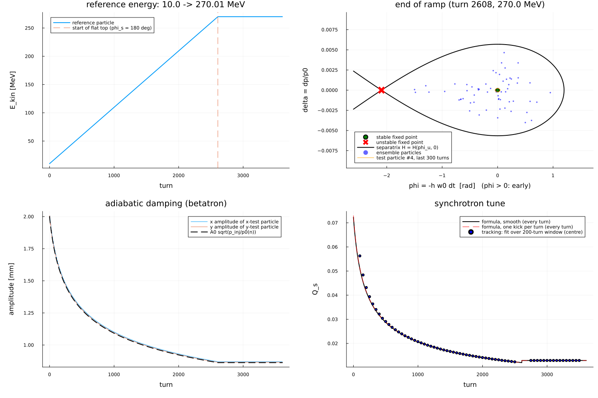

# Ускорение и адиабатическое затухание

Накопитель с ``\sin\varphi_s=0`` или с ``ZV\sin\varphi_s``, гасящим постоянные потери, держит ``p_0`` постоянным. Отображение за оборот — одно и то же симплектическое отображение на каждом обороте.

## Движущаяся опора

Если ``\sin\varphi_s\neq 0``, гамильтониан однородного зазора содержит член, линейный по временной координате. Начало ``l=\delta=0`` больше не решение. Естественные координаты следуют за опорным импульсом ``p_0(s)`` с

```math
\frac{\mathrm{d}p_0}{\mathrm{d}s}=\frac{ZV\sin\varphi_s}{v_0 L},
```

так что синхронная частица остаётся опорной. Переход к переменным, нормированным на это ``p_0(s)``, добавляет к ``H``

```math
\Delta H=\frac{p_0'}{p_0}\Big[x\,p_x+y\,p_y+l\,(1+\delta)\Big].
```

На оси при ``\delta=0`` линейный член ВЧ и ``-\partial(\Delta H)/\partial l`` сокращаются, и ``l=\delta=0`` снова решение. ``\beta_0``, ``\gamma_0`` и ``k=2\pi h\beta_0/C`` становятся функциями ``s``.

В трекере та же мысль применяется один раз за проход тонкого резонатора. После толчка синхронную частицу объявляют новой опорой (`renormalize`): положения не меняются, запаздывание отсчитывают от синхронной частицы, и

```math
p_0'=p_0(1+\delta_s),\qquad
1+\delta'=\frac{1+\delta}{1+\delta_s},\qquad
p_x'=\frac{p_x}{1+\delta_s},\qquad
p_y'=\frac{p_y}{1+\delta_s}.
```

Магниты при разгоне следят за ``p_0`` (нормированные силы постоянны). Частота ВЧ следует за ``h\omega_0(p_0)``.

## Где теряется симплектичность

Пока ``p_0`` фиксирован, толчок симплектичен в ``z``. При ускорении гамильтониан зависит от ``s`` через ``p_0(s)``, и система не автономна: у каждого оборота своё отображение ``\mathcal{M}_n``. Поток по-прежнему гамильтонов, поэтому каждое ``\mathcal{M}_n`` симплектично в размерных, ненормированных переменных.

Замена опоры не есть симплектическое отображение в нормированных координатах. Время прихода и положения не меняются:

```math
\begin{aligned}
l_{\mathrm{new}}&=l_{\mathrm{old}},\\
1+\delta_{\mathrm{new}}&=(1+\delta_{\mathrm{old}})\frac{p_{0,\mathrm{old}}}{p_{0,\mathrm{new}}},\\
p_{x,y,\mathrm{new}}&=p_{x,y,\mathrm{old}}\frac{p_{0,\mathrm{old}}}{p_{0,\mathrm{new}}}.
\end{aligned}
```

Определитель в каждой плоскости равен ``p_{0,\mathrm{old}}/p_{0,\mathrm{new}}<1`` (а произведение трёх плоскостей — куб этого множителя). Фазовый объём в нормированных переменных сжимается. Это сжатие и есть адиабатическое затухание: размерный ``P_x=p_0 p_x`` продольное поле оставляет неизменным, поэтому ``p_x\propto 1/p_0``.

Действие Курранта–Снайдера в нормированных переменных тогда масштабируется как ``J\propto 1/p_0``, а бетатронные амплитуды затухают как

```math
\frac{A(n)}{A(0)}=\sqrt{\frac{p_{\mathrm{inj}}}{p_0(n)}}.
```

## Адиабатическое чтение

Если ``p_0`` меняется медленно по сравнению с синхротронным периодом,

```math
\frac{1}{\gamma_0}\frac{\mathrm{d}\gamma_0}{\mathrm{d}t}\ll Q_s\omega_0,
```

отображение оборота можно заморозить: при каждом ``p_0`` строят автономное ``\mathcal{M}(p_0)``, читают замкнутую орбиту, частоты и бакет, затем медленно двигают ``p_0``. Действия — адиабатические инварианты, и нормированные амплитуды падают степенью ``p_0``. Чтение отказывает там, где параметры движутся быстро по сравнению с собственной частотой: вблизи критической энергии, где ``Q_s\to 0``, и при быстром прохождении резонанса.


