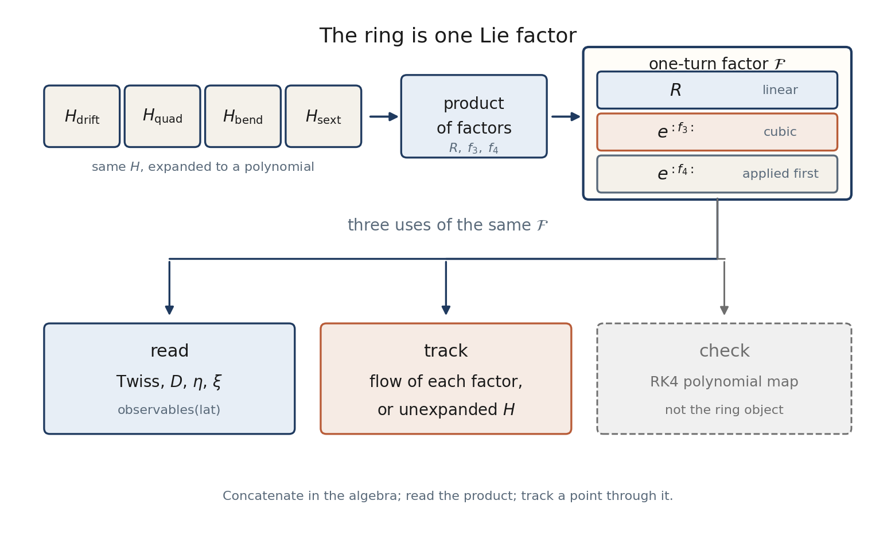

# Руководство по физике пучка

**BELL — Beam Evolution in Accelerator Lattice**

**Автор:** Колокольчиков Сергей Дмитриевич (`sergey.bell13@gmail.com`)

Симплектическое описание заряженной частицы в магнитной структуре с ВЧ-резонатором.
Независимая переменная — длина дуги ``s`` вдоль опорной орбиты.
Модель элемента — его ``s``-гамильтониан ``H``. Уравнения
``\mathrm{d}z/\mathrm{d}s = S\nabla H`` и отображения элемента выводятся из ``H``.
Лабораторные углы и фаза ВЧ — выходные величины, а не координаты фазового пространства.

Объект, который читает оптика, — произведение преобразований Ли. У каждого магнита
и у толстого резонатора один ``H``. На пути Ли этот ``H`` становится фактором
Драгта–Финна ``R\circ e^{:f_3:}\circ e^{:f_4:}``. Сцепление в алгебре даёт
фактор оборота ``\mathcal{F}``. Твисс, проскальзывание, хроматичность и нормальная
форма — чтения ``\mathcal{F}``. Точку можно провести точным потоком этих факторов
или интегрированием неразложенного ``H``. Обрезанное тейлоровское отображение —
проверка. Оно не задаёт кольцо.

Линейная оптика, проскальзывание второго порядка и хроматичность — однородные
куски одного многочлена, а не отдельные теории.

Это руководство — физика. Тот же список глав есть по-английски в
`docs/manual/en/`. Рисунки общие, в `docs/manual/assets/`. Как каждый
путь соединён в дереве исходников, сказано в главе [Пути вычисления](computation_paths.md).
Руководство программиста остаётся в `docs/manual/programmer/`.

Содержание:

1. [Координаты, единицы, опорная частица](coordinates.md)
2. [s-гамильтониан](hamiltonian_s.md)
3. [Гамильтонианы элементов](hamiltonians.md)
4. [Краевые поля](fringe.md)
5. [Линейная оптика](linear.md)
6. [Произведение Ли кольца](lie.md)
7. [Чтения отображения за оборот](map_readings.md)
8. [Нормальная форма и равновесный импульс](normal_form.md)
9. [Движение в ВЧ](rf.md)
10. [Ускорение и адиабатическое затухание](acceleration.md)
11. [Продольное движение из среднего по кольцу](longitudinal.md)
12. [Семейства секступолей](sextupoles.md)
13. [Факторы Ли и дифференциальная алгебра](lie_and_da.md)
14. [Пути вычисления](computation_paths.md)
15. [Спин](spin.md)
16. [Допущения](assumptions.md)

Рисунки сделаны на решётке нуклотронного типа при кинетической энергии
дейтрона 270 МэВ, если не показан разгон от 10 МэВ.
