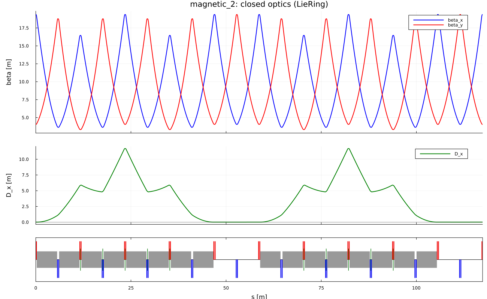

# Линейная оптика

Линейное отображение элемента — замкнутая форма квадратичного преобразования Ли ``\exp(:f_2:)``. При
``\mathcal{H}_{ij}=\partial^2 H/\partial z_i\partial z_j|_0``

```math
R=\exp(L\,S\,\mathcal{H}).
```

Это не транспортная матрица из учебника: гессиан берётся из того же ``H``, который порождает нелинейный фактор. Для графиков вдоль ``s`` матрицы перемножают от элемента к элементу. Для оптики кольца за оборот ``\mathtt{observables}`` читает линейный фактор ``\mathcal{F}.R`` произведения Ли, а не второе, независимое матричное произведение.

При ``\cos\mu=\tfrac12\mathrm{Tr}M_x``

```math
\beta=\frac{M_{12}}{\sin\mu},\qquad
\alpha=\frac{M_{11}-M_{22}}{2\sin\mu},
```

а замкнутая дисперсия решает ``(I-M_4)D=M_{\cdot 6}``. Уплотнение орбит в первом порядке:

```math
\alpha_0=\frac{1}{\gamma_0^2}-\frac{(l|\delta)_{\mathrm{closed}}}{C}
=\frac1C\oint h\,D\,\mathrm{d}s.
```

Твисс и дисперсия, проведённые по срезам, замыкаются после оборота с машинной точностью.


