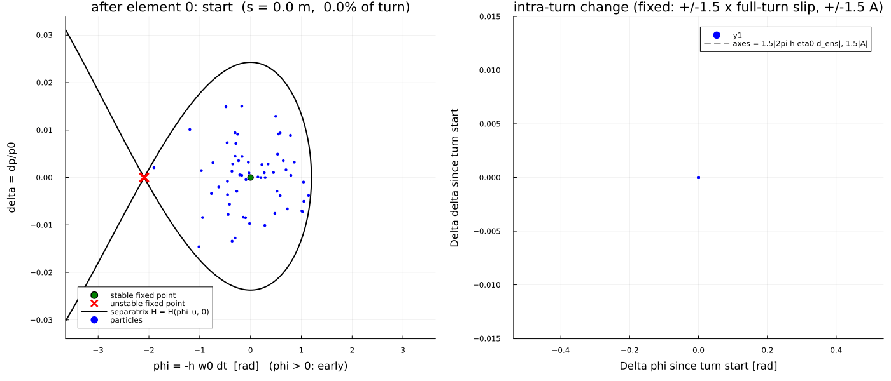

# Продольное движение из среднего по кольцу

Шестимерный ``H`` продвигает ``(l,\delta)`` от элемента к элементу. Коэффициенты проскальзывания ``\eta_0`` и ``\eta_1`` — это коэффициенты времени пролёта, прочитанные в главе [Чтения отображения за оборот](map_readings.md). Тонкий ВЧ-толчок меняет ``\delta`` при фиксированном времени прихода. Огрубление до одного отображения за оборот в ``(\varphi,\delta)``, с ``\varphi=-h\omega_0\Delta t``, даёт

```math
\begin{aligned}
\varphi_{n+1}&=\varphi_n-2\pi h\bigl(\eta_0\delta_{n+1}+\eta_1\delta_{n+1}^2+\cdots\bigr),\\
\delta_{n+1}&=\delta_n+A\bigl(\sin(\varphi_s+\varphi_n)-\sin\varphi_s\bigr),
\qquad
A=\frac{ZV}{\beta_0^2 E_0}.
\end{aligned}
```

``\eta_0`` — линейное проскальзывание. ``\eta_1`` — квадратичное. Это среднее: одна ВЧ-станция, поперечно-продольная связь в усреднённых уравнениях не сохранена, и ``\delta`` достаточно мало, чтобы разложение длины пути по замкнутой орбите сходилось. Решётку это среднее не интегрирует.

Если номер оборота считать непрерывным, получается гладкий гамильтониан

```math
\bar H(\varphi,\delta)
=-2\pi h\Bigl(\frac{\eta_0\delta^2}{2}+\frac{\eta_1\delta^3}{3}\Bigr)
+A\bigl(\cos(\varphi_s+\varphi)+\varphi\sin\varphi_s\bigr).
```

Черта отмечает среднее за один оборот. ``\bar H`` — не ``s``-гамильтониан элемента. Неподвижные точки на ``\delta=0``: устойчивая ``\varphi=0``, неустойчивая ``\varphi_u=\pi-2\varphi_s``. Сепаратриса — линия уровня ``\bar H=\bar H(\varphi_u,0)``. Бакет — область вокруг начала внутри неё. Устойчивость требует ``\eta_0\cos\varphi_s>0``.

Синхротронная частота малой амплитуды, гладкая и при одном толчке за оборот:

```math
Q_s=\sqrt{\frac{h\,\eta_0\,ZV\cos\varphi_s}{2\pi\beta_0^2 E_0}},
\qquad
\cos(2\pi Q_s^{\mathrm{kick}})=1-\tfrac12(2\pi Q_s)^2.
```

Корень — то же чтение, что в главе [Движение в ВЧ](rf.md).

## Что ``\eta_1`` делает с бакетом

При одном лишь ``\eta_0`` портрет — маятник. Сепаратриса симметрична относительно ``\delta\to-\delta``. При ``\sin\varphi_s=0`` полувысота есть ``\delta_{\max}=\sqrt{2A/(\pi h|\eta_0|)}`` в нормировке ``\bar H`` выше. Численный множитель следует из ``A`` и из ``\mathrm{d}\varphi/\mathrm{d}t=-h\omega_0\eta_0\delta``.

С ``\eta_1`` равенство ``\mathrm{d}\varphi/\mathrm{d}t=0`` выполняется также при ``\delta_*=-\eta_0/\eta_1``. Появляется вторая цепочка неподвижных точек. Эффективное проскальзывание ``\partial(\eta_0\delta+\eta_1\delta^2)/\partial\delta`` имеет там противоположный знак, так что точка, устойчивая при ``\delta=0``, неустойчива при ``\delta_*``, и наоборот. Кубический член делает сепаратрису несимметричной. Пока ``|\delta_*|\gg\delta_{\max}``, поправка имеет порядок ``\eta_1\delta_{\max}/\eta_0``.

Вблизи критической энергии ``\eta_0\to 0``, поэтому ``Q_s\to 0``, и адиабатическое чтение главы [Ускорение](acceleration.md) отказывает. ``\delta_{\max}`` растёт, ``\delta_*`` попадает внутрь бакета, и господствует нелинейное проскальзывание. При ``\eta_0=0`` линейной продольной фокусировки нет.

## Один оборот, от элемента к элементу

Слева: абсолютные ``(\varphi,\delta)`` с аналитической сепаратрисой. Справа: изменение относительно начала оборота, на осях, заданных решёткой и напряжением ВЧ. Внутри оборота ``\delta`` меняет только резонатор. ``\varphi`` меняется вдоль всего кольца из-за длины пути и скорости.



