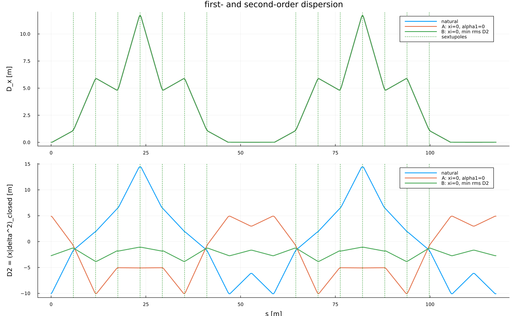
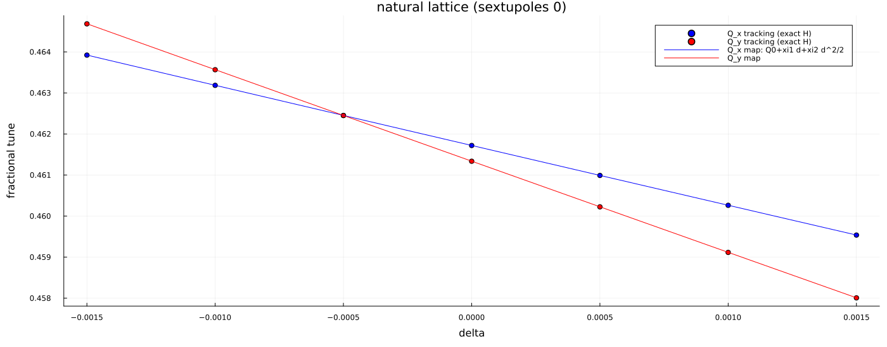

# Чтения отображения за оборот

Параметры Твисса, дисперсия, коэффициент уплотнения орбит, фактор проскальзывания и хроматичность — чтения одного многочлена. Линейная матрица не видит ``D_2`` и ``\eta_1``. Хроматичность не выводят из функций Твисса. Произведение Ли разлагают лишь настолько, чтобы прочитать коэффициент. Построение отображения не входит в чтение.

## Замкнутая орбита по ``\delta``

Без ВЧ величина ``\delta`` постоянна. Поперечная замкнутая орбита допускает

```math
z_\perp(\delta)=D_1\delta+D_2\delta^2+O(\delta^3),
```

из ``M_\perp(z_\perp(\delta),\delta)=z_\perp(\delta)`` порядок за порядком. ``D_1`` — обычная дисперсия. ``D_2`` — дисперсия второго порядка.

## Длина пути и уплотнение орбит

На этой орбите геометрическая длина окружности есть

```math
\frac{C(\delta)}{C_0}=1+\alpha_0\delta+\alpha_1\delta^2+\alpha_2\delta^3+\cdots.
```

При ``l=-v\Delta t`` один оборот даёт ``\Delta l=-C(\delta)+C_0\,v(\delta)/v_0``, откуда

```math
\alpha_0=-\frac{l_1}{C}+\frac{1}{\gamma_0^2},\qquad
\alpha_1=-\frac{l_2}{C}+c_2,\qquad
\alpha_2=-\frac{l_3}{C}+c_3,
```

где ``v/v_0-1=c_1\delta+c_2\delta^2+c_3\delta^3`` и ``c_1=1/\gamma_0^2``. Эквивалентно, ``\alpha_i`` можно подогнать по ``C(\delta)/C_0`` на замкнутых орбитах при нескольких ``\delta``. В первом порядке то же уплотнение есть интеграл кривизны против дисперсии,

```math
\alpha_0=\frac{1}{C}\oint h\,D\,\mathrm{d}s.
```

## Фактор проскальзывания

Относительное изменение периода обращения — время пролёта одного оборота. При ``l=-v\Delta t`` имеем ``\Delta T/T_0=-(l/C)/(v/v_0)``, так что на замкнутой орбите

```math
\eta_0=-\frac{l_1}{C}=\alpha_0-\frac{1}{\gamma_0^2},
```

```math
\eta_1=-\frac{l_2}{C}+\frac{l_1}{C}\,\frac{1}{\gamma_0^2}
=\alpha_1-\frac{\alpha_0}{\gamma_0^2}+\frac{3\beta_0^2}{2\gamma_0^2}+\frac{1}{\gamma_0^4}.
```

``\eta_0`` — линейное проскальзывание. ``\eta_1`` — квадратичное. Это коэффициенты усреднённого продольного гамильтониана. Они берутся из фактора оборота, разложенного в многочлен только ради ``l_1`` и ``l_2``.

Их порождают два эффекта. Путь удлиняется, потому что дисперсионная орбита задевает повороты, ``C/C_0=1+\alpha_0\delta+\alpha_1\delta^2+\cdots``. Скорость меняется,

```math
\frac{\beta_0}{\beta}=1-\frac{\delta}{\gamma_0^2}+\Big(1+\frac{\beta_0^2}{2}\Big)\frac{\delta^2}{\gamma_0^2}+\cdots.
```

Произведение есть ``T/T_0-1=\eta_0\delta+\eta_1\delta^2+\cdots``. Выше критической энергии ``\eta_0>0``. При ``\gamma_0\to\infty`` имеем ``\eta_1\to\alpha_1``.



## Хроматичность

При фиксированном ``\delta`` поперечное движение около ``z_\perp(\delta)`` линеаризуют. Частоты из ``\cos 2\pi Q=\tfrac12\mathrm{Tr}\,J(\delta)`` разлагаются как

```math
Q(\delta)=Q_0+\xi_1\delta+\tfrac12\xi_2\delta^2.
```

Поскольку без ВЧ величина ``\delta`` сохраняется, это инварианты отображения за оборот. Кусок степени 3 — то, чего не видит матрица ``6\times 6``. Перекрёстная проверка интегрирует неразложенные гамильтонианы при нескольких ``\delta`` и подгоняет частоту малого бетатронного колебания.



## Что не является чтением

Распространение Твисса и дисперсии от среза к срезу — то же произведение линейных матриц, записанное вдоль ``s``. Оно замыкается после оборота с машинной точностью и остаётся степенью 1. Дисперсию второго порядка, ``\eta_1`` и ``\xi_1`` читают из старших однородных кусков или из отображения ``H`` в дифференциальной алгебре, а не из второй оптической теории.
