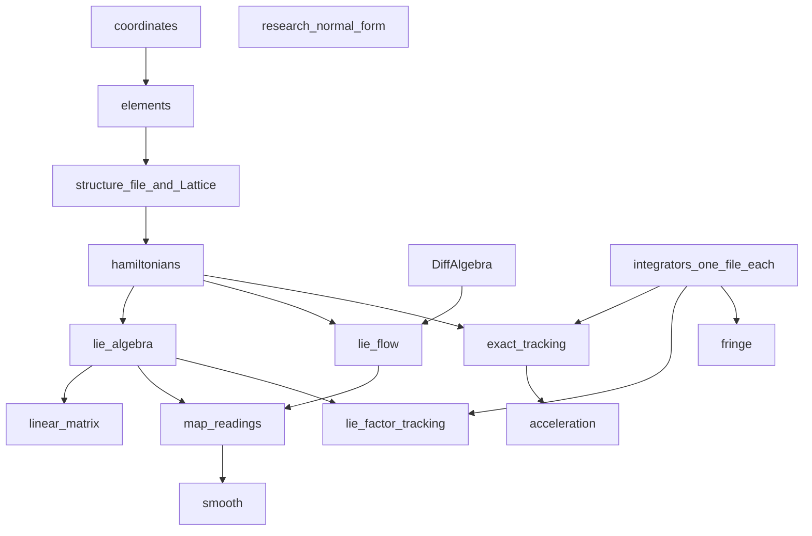

# Bell architecture

**Author:** Kolokolchikov Sergey Dmitrievich  
**Email:** sergey.bell13@gmail.com

Bell is a Julia program for symplectic modelling of a magnetic ring. There is
one scheme: a formulation of the element Hamiltonian, a truncation of that
formulation, and an integrator of the resulting field. Linear optics and
higher-order numbers are readings of a map. Smooth motion in `(φ, δ)` is a
separate averaged equation, not a fourth tracker.

This page describes the program: blocks, how they call each other, and the
structure file. Physics is in the Beam Physics Manual.

## Blocks



| File | Block | Role |
|------|--------|------|
| `src/coordinates.jl` | Coordinates | Particle, reference, canonical `(x, px, y, py, l, δ)` and laboratory `(x, x', y, y', φ, δ)` |
| `src/elements.jl` | Elements | Data types only: drift, sector bend, quadrupole, sextupole, thin RF, long cavity, marker |
| `src/structure.jl` | Structure | Named parameters, element cards, sequence of names, `Lattice` |
| `src/hamiltonians.jl` | Hamiltonians | Polynomial `H` and exact vector fields of the same equations |
| `src/lie_algebra.jl` | Lie algebra | Poisson bracket, Lie series, Dragt–Finn factor, product of factors (order-3 path) |
| `src/lie_flow.jl` | Lie flow | Flow of `H` to the order of the call (`DiffAlgebra`) |
| `src/tracking.jl` | Tracking | Flow of each truncated factor; Taylor map of the same `H` |
| `src/exact_integrator.jl` | Exact tracking | Unexpanded `H`, chosen integrator, long cavity, `rf_kick`, `renormalize` |
| `src/linear.jl` | Linear | `R = exp(L S Hess H)`, periodic Twiss, optics along `s` |
| `src/map_readings.jl` | Map readings | Closed orbit, chromaticity, compaction, maxima of optics |
| `src/smooth.jl` | Smooth | Averaged turn-by-turn motion in `(φ, δ)` through `η1` |
| `src/acceleration.jl` | Acceleration | Reference ramp through the exact tracker |
| `src/fringe.jl` | Fringe | Hard-edge thin lenses and soft-edge `Body(-W)∘Soft∘Drift(-W)` |
| `src/symplectic.jl` | Symplectic | `max |Jᵀ S J − S|` of a matrix, a series map, or a tracking step |
| `src/integrators/` | Integrators | One file per ODE method; no accelerator equations |
| `src/da/` | DiffAlgebra | Truncated power series of any order |
| `src/sextupole_families.jl` | Sextupole families | Optional placement and fitting of families |
| `src/optimizers/` | Optimizers | Stubs `GridSearch`, `RandomStart` |
| `src/plotting/` | Plotting | Figures. No physics |
| `src/research/normal_form.jl` | Normal form | Research; not exported by `using Bell` |
| `src/optim_converter.jl` | Converter | Writes a structure file from an OptiM `.opt` |

A script loads a structure file and calls readers. An application of a
concrete ring lives outside this package and depends on it. Research names
are loaded with `using Bell.NormalForm`.

## One scheme

The Hamiltonian of an element is written once. The polynomial in
`hamiltonians.jl` and the exact fields `magnetic_field` / `cavity_field` are
two formulations of the same equations, truncated and unexpanded. After the
split, both live next to `H`. A tracker does not rewrite them.

Truncation of a series to a chosen order is a property of that formulation.
A higher order is the same formulation with a weaker cut, not a new tracker.
`lie_flow.jl` already does this to the order of the call.

Lie tracking in `tracking.jl` sends a point through a Dragt–Finn factor:
the flow of `f4`, then `f3`, then the matrix `R`. The generators are the
expansion of the truncated `H`. Their flow is the implicit midpoint, which
is the same integrator family as the exact tracker.

An integrator contains no equations. It is given a ready field: closed
formulas or series coefficients. Exact tracking of an element and a Taylor
map are two such calls. The step is chosen by `method`.

Thin `rf_kick` and the long cavity are two formulations of the longitudinal
kick (zero length and finite length). The ramp in `acceleration.jl` only
decides when to change the phase and when to update the reference. It calls
the tracker; it does not write a third equation of motion.

## Smooth model

`smooth.jl` does not track the ring in 6D. It is the average of one turn in
`(φ, δ)`:

```text
dφ/dn     = −2π h (η₀ δ + η₁ δ²)
dδ/dn     = (Z V T / (β² E)) (sin(φ_s + φ) − sin φ_s)
```

`η` is taken from a map reading. The ring product does not use this model.
A higher order of the same smooth model would be further `η` from the same
readings, in this file. This revision keeps the cut at `η1`. Synchrotron
tune, separatrix and bucket height are readings of this `H`.

## Where the orders come from

Linear optics and higher-order optics are homogeneous pieces of one
one-turn Lie factor

```text
F = R ∘ exp(:f₃:) ∘ exp(:f₄:)
```

`observables(lattice)` builds that factor once. Twiss and `η₀` come from
degree 1 (`F.R`). `D₂` and `η₁` come from degree 2 of the polynomial of
`F`. Chromaticity `ξ₁` comes from degree 3. The Taylor map is a check of
the same `H`, not the source of these numbers.

An element in the structure file is a card of parameters. It is not a
procedure that writes into a global map. `hamiltonians.jl` writes `H`.
The Lie algebra builds a factor from `H`. A Taylor map repeats the flow of
the same `H` as a truncated polynomial and stops there.

## Structure file

Three parts in one file. The sequence holds names only. Numbers of an
element sit on its card. Named parameters sit above the cards so an
optimizer changes a name, not a line of the sequence. A quadrupole is
written once. The sequence repeats its name as many times as the magnet
stands in the ring.

```text
reference
  particle deuteron
  kinetic_MeV 270
  harmonic 1

parameters
  L_d = 2.0
  k_f = 0.3

elements
  D1   drift        L = L_d
  QF   quadrupole   L = 0.4    k1 = k_f
  QD   quadrupole   L = 0.4    k1 = -k_f
  B1   sbend        L = 1.5    angle = 0.3926990817

sequence cell
  D1 QF D1 B1 D1 QD D1 B1

sequence
  16 * cell
```

Units are those that already enter the Hamiltonian:

- length: m
- bend angle: rad (`deg` on a card is converted when the file is read)
- `k1`: 1/m², `k2`: 1/m³
- RF voltage: MV per unit charge; phase: rad; harmonic: integer
- kinetic energy and rest energy: MeV

Magnetic rigidity is not stored. It is computed from the reference
particle. `16 * cell` repeats an already expanded list of names. There
are no loops, conditions or matching commands.

`load_structure` builds a `Lattice`. `convert_optim` writes this file
from an OptiM `.opt`. The OptiM reader does not assemble a `Lattice`.

## Coordinates kept by Bell

Independent variable: arc length `s` along the reference orbit.

Canonical variables, used in every Hamiltonian and every map:

```text
z = (x, px, y, py, l, δ)
px = Px / p0,   py = Py / p0
l  = −v(δ) dt     [m]
δ  = (p − p0) / p0
```

Laboratory coordinates `(x, x', y, y', φ, δ)` are input and output only:

```text
x'  = px / ps
φ   = −h ω₀ dt     (late particle: dt > 0 ⇒ φ < 0)
```

## Install

From the package root:

```julia
using Pkg
Pkg.activate(".")
Pkg.instantiate()
using Bell
```
