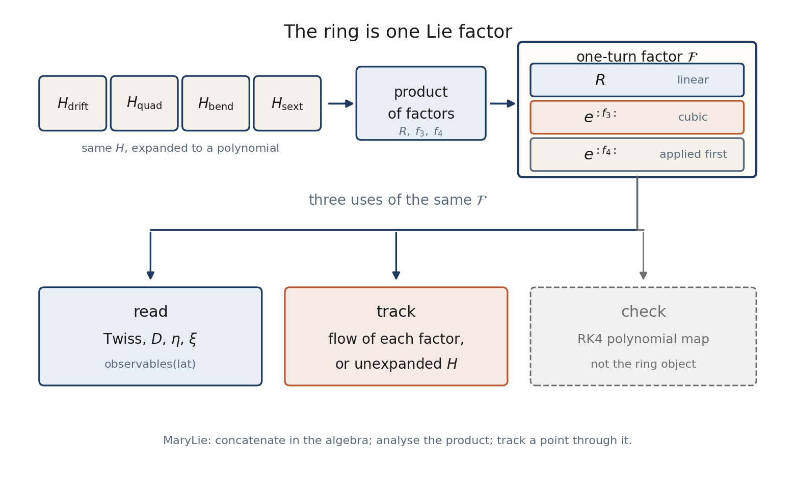

# Programmer Manual

Physics is in the [Beam Physics Manual](../index.md). Architecture of the
blocks is in [Architecture](../architecture.md). This page lists entry
points of the Julia package `Bell`.

The object of the ring is the Lie product of Dragt–Finn factors.
Concatenate in the algebra, read the product, track a point through it.
Linear optics is the closed form of ``\exp(:f_2:)``, stored as the matrix
``R``. It is not a second theory of the lattice.



`observables(lat)` builds `ring_lie_factor` once and reads Twiss,
``\eta`` and ``\xi`` from that factor. `ring_taylor_map` is an RK4
polynomial and is not that object.


## Where each algorithm is written out

| question | page |
|:--|:--|
| which Hamiltonian, matrix, polynomial map and Lie generators each element produces (with ``\delta``-dependence) | [Elements: explicit maps](elements.md) |
| how a particle is integrated through an element and through one turn; the RF kick; how ``p_0`` is ramped | [Tracking](tracking.md) |
| whether the longitudinal motion is truncated (it is not, in 6D tracking) | [RF & longitudinal](rf.md) |
| how Twiss, dispersion, tunes, ``\alpha_c`` and ``\xi`` are extracted, and from which order | [Optics](optics.md) |
| the steps of the normal form | [Normal form](normal_form.md) |
| field profiles, edge maps and how edges are inserted | [Fringe fields](fringe.md) |

## Layout

| path | role |
|---|---|
| `src/coordinates.jl` | particle, reference, ``v(\delta)``, ``e(\delta)``, ``z\leftrightarrow u`` |
| `src/elements.jl` | element types (data only) |
| `src/structure.jl` | structure file, `Lattice`, sequence edits |
| `src/hamiltonians.jl` | element generator ``H`` as a polynomial |
| `src/lie_algebra.jl` | polynomial space, Poisson bracket, Dragt–Finn product |
| `src/optim_converter.jl` | writes a structure file from OptiM ``.opt`` |
| `src/linear.jl` | ``R=\exp(L S \mathrm{Hess}\,H)``, slice Twiss along ``s`` |
| `src/symplectic.jl` | ``J^\mathsf{T}SJ-S`` |
| `src/tracking.jl` | flow of each factor, thin RF kick, product of the ring |
| `src/higher_order.jl` | closed orbit, ``D_2``, ``\eta``, chromaticity, `observables` |
| `src/differential_algebra.jl` | independent DA map (RK4 in polynomials) — a check |
| `src/normal_form.jl` | one-turn factor with thin RF; torus average of ``\delta`` |
| `src/fringe.jl` | edge models (hard / soft) as thin maps chosen at build time |
| `src/longitudinal.jl` | averaged longitudinal Hamiltonian in ``(\varphi,\delta)`` (analysis only, not used by tracking) |
| `src/exact_integrator.jl` | unexpanded ``H``, finite cavity, renormalise |
| `src/acceleration.jl` | ramp, tune fit |
| `src/plotting.jl` | figures |
| `src/optimizers.jl` | optional sextupole response |
| `src/Bell.jl` | loads every block and re-exports |

Entry: from the `Julia` folder, `using Bell`.

The one-turn object used for the normal form is `one_turn_factor_rf`.
Optics of the magnetic product without RF is `observables(lat)`.

## Examples

```
julia --project=. examples/10_linear_optics.jl
julia --project=. examples/11_lie_maps.jl
julia --project=. examples/12_higher_order.jl
julia --project=. examples/13_optional_sextupole_optimization.jl
julia --project=. examples/14_rf_acceleration.jl
julia --project=. examples/15_coordinates.jl
julia --project=. examples/16_blond_longitudinal.jl
julia --project=. examples/17_lie_product.jl
julia --project=. examples/18_lie_normal_form.jl
```

The equilibrium-momentum study lives in `C:\GIT_REPOS\SCT_2\Julia\equilibrium_energy`.
It depends on this package via `Pkg.develop` of the `Julia` folder.

## Accepted design choices

- Injection kinetic energy 10 MeV; final 270 MeV from the lattice header.
- Stationary study: thin RF, ``V=0.2`` MV, ``h=5``, ``\varphi_s=\pi``.
- Ramp demo: finite cavity ``L=1`` m, ``\varphi_s=150^\circ``.
- Mass = CODATA deuteron ``1875.61294257`` MeV (OptiM `Mass=2*938.272` ignored).
- Lattice sequence used once (file `Number of periods=2` is an error; bend is 360 deg).
- Closed ``D(0)=0.011`` m (OptiM initial 0 is not the closed solution).
- Default sextupole strengths are zero.

## Docs build

```
julia --project=docs docs/make.jl
```

Developer: Kolokolchikov Sergey Dmitrievich, sergey.bell13@gmail.com.

## Fringe fields (`src/fringe.jl`)

Module `Fringe`. The lattice stays physical (an `SBend` carries `e1`, `e2`,
`gap`, `fint`; the structure file accepts the same keys). The edge model is
an argument of the ring construction:

```julia
model = FringeModel(dipole = SoftEdge(profile = Enge(gap = 0.05),
                                      method  = Splitting(n = 20, order = 4)),
                    quad = HardEdge(order = 2), sext = NoEdge(),
                    override = Dict("BM" => HardEdge(order = 2)))
F   = ring_lie_factor(lat, model)      # one-turn LieFactor with edges
obs = fringe_observables(lat, model)   # Qx, Qy, xi, symplecticity, time
```

`FringeModel()` (all `NoEdge`) returns the element list unchanged, so the
result is identical to `ring_lie_factor(lat)`.

| type | role |
|---|---|
| `EdgeModel` | `NoEdge`, `HardEdge(order, gap, fint)`, `SoftEdge(profile, method)` |
| `FringeProfile` | `Enge(coeffs; gap)`, `Tanh(lambda)`, `LinearRamp(width)`, `Tabulated(z, B)` |
| `FringeMethod` | `Splitting(n, order)`, `Magnus(n, order)`, `TaylorIntegrate(tol)` |
| `FringeModel` | model per family (`dipole`, `quad`, `sext`) and per element name (`override`) |
| `EdgeMap` | thin item `(name, parent, side, model)` placed around the parent |

Flow:

1. `fringe_sequence(lat, model)`: every magnet with a model other than
   `NoEdge` becomes `EdgeMap(:in)`, element, `EdgeMap(:out)`.
2. `edge_map(E, ref)`: polynomial map of an edge (cached by parent, side,
   model, momentum). Hard edges are `lie_map(K, 1)` of a generator.
   Soft edges: `profile_function` gives ``F`` with the EFB at 0 (equal area)
   and the half-width ``W``; the method integrates the region; the result
   is wrapped as `Body(-W) o Soft o Drift(-W)` (entrance) or
   `Drift(-W) o Soft o Body(-W)` (exit) so neighbouring elements keep
   their lengths.
3. `build_factors(lat, model)`: Dragt–Finn factor of every element and
   every edge; `ring_lie_factor(lat, model)` multiplies them.

The body Hamiltonians in `hamiltonians.jl` are not used for the fringe
region except as `Body(-W)` in the wrapper. New profiles need `_raw(p, z)`
and `_halfwidth(p)`; new methods need `_soft(E::_Edge, m, ref)`; new edge
models need a method of `edge_map`.

Example: `examples/19_fringe_models/run.jl` runs every model, the
``g\to 0`` limit, the convergence in ``n`` and the symplecticity check.
