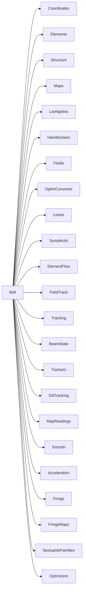

# Dependency map of `src/`

An arrow `A → B` means: in `src/`, module `A` depends on module `B`. An edge comes from a `using` or `import`. An `include` is not an edge: it only inserts a file into a module that is already open.

The layer chain that decides whether an edge points toward a layer further to the right is the one in the header of `Bell.jl`:

```text
math → core → io → physics → maps → analysis → tracking → longitudinal_models → optimizers → research
```

`Bell.jl` includes files in that order as far as the remaining edges allow. `Hamiltonians` stays after `LieAlgebra`, because the Taylor entry of `hamiltonian` uses `Z` and `JET_ORDER`. `FringeMaps` stays after `MapReadings`, because `fringe_observables` reads a map that is already built. `NormalForm` is included last.

Here `tracking` is the directory `src/tracking` (`BeamState`, `Trackers`). The `Tracking` module in `maps/lie/tracking.jl` stays in the `maps` layer. `NormalForm` lives under `maps/lie/`. Its header calls it a research layer: it is included last and is absent from the `using` of the `Bell` facade. On the diagram it sits in `research`, to the right of `optimizers`.

A solid arrow stays inside one layer or points toward a layer further to the left. A dotted arrow points toward a layer further to the right: a lower layer depending on an upper one.

## Module diagram

```mermaid
flowchart TB
  subgraph mathL["math"]
    DiffAlgebra
    Integrators
  end
  subgraph coreL["core"]
    Coordinates
    Elements
    Structure
    Symplectic
  end
  subgraph ioL["io"]
    OptimConverter
  end
  subgraph physL["physics"]
    Hamiltonians
    Fields
    Fringe
  end
  subgraph mapsL["maps"]
    Maps
    LieAlgebra
    Linear
    Tracking
    ElementFlow
    FieldTrack
    DATracking
    FringeMaps
  end
  subgraph analysisL["analysis"]
    MapReadings
    SextupoleFamilies
  end
  subgraph trackIface["tracking"]
    BeamState
    Trackers
  end
  subgraph longL["longitudinal_models"]
    Smooth
    Acceleration
  end
  subgraph optL["optimizers"]
    Optimizers
  end
  subgraph researchL["research"]
    NormalForm
  end

  Integrators --> DiffAlgebra
  Structure --> Coordinates
  Structure --> Elements
  Symplectic --> Coordinates
  Symplectic --> DiffAlgebra
  SextupoleFamilies --> Coordinates
  SextupoleFamilies --> Elements
  SextupoleFamilies --> Structure
  SextupoleFamilies --> MapReadings
  OptimConverter --> Coordinates
  OptimConverter --> Elements
  OptimConverter --> Structure
  Hamiltonians --> Coordinates
  Hamiltonians --> Elements
  Hamiltonians -.-> LieAlgebra
  Fields --> Coordinates
  Fields --> Elements
  Fringe --> Coordinates
  Fringe --> Elements
  Fringe --> Structure
  FringeMaps --> Coordinates
  FringeMaps --> Elements
  FringeMaps --> Structure
  FringeMaps --> Hamiltonians
  FringeMaps --> Fringe
  FringeMaps --> LieAlgebra
  FringeMaps --> Symplectic
  FringeMaps --> Tracking
  FringeMaps --> Integrators
  FringeMaps --> ElementFlow
  FringeMaps -.-> MapReadings
  Maps --> DiffAlgebra
  LieAlgebra --> Maps
  LieAlgebra --> Coordinates
  LieAlgebra --> Symplectic
  Linear --> Coordinates
  Linear --> Elements
  Linear --> Structure
  Linear --> Hamiltonians
  Linear --> LieAlgebra
  Tracking --> Coordinates
  Tracking --> Elements
  Tracking --> Structure
  Tracking --> Hamiltonians
  Tracking --> LieAlgebra
  Tracking --> Integrators
  Tracking --> ElementFlow
  ElementFlow --> DiffAlgebra
  ElementFlow --> Integrators
  ElementFlow --> Coordinates
  ElementFlow --> Elements
  ElementFlow --> Hamiltonians
  FieldTrack --> Coordinates
  FieldTrack --> Elements
  FieldTrack --> Structure
  FieldTrack --> Integrators
  FieldTrack --> ElementFlow
  DATracking --> DiffAlgebra
  DATracking --> Integrators
  DATracking --> Coordinates
  DATracking --> Elements
  DATracking --> Structure
  DATracking --> ElementFlow
  DATracking --> FieldTrack
  MapReadings --> Coordinates
  MapReadings --> Elements
  MapReadings --> Structure
  MapReadings --> LieAlgebra
  MapReadings --> Linear
  MapReadings --> Tracking
  MapReadings --> DATracking
  MapReadings --> DiffAlgebra
  Trackers --> BeamState
  Trackers --> Structure
  Trackers --> Integrators
  Trackers --> FieldTrack
  Trackers --> Tracking
  Trackers --> LieAlgebra
  Smooth --> Coordinates
  Acceleration --> Coordinates
  Acceleration --> Elements
  Acceleration --> Structure
  Acceleration --> FieldTrack
  NormalForm --> LieAlgebra
  NormalForm --> Coordinates
  NormalForm --> Elements
  NormalForm --> Structure
  NormalForm --> Tracking
  NormalForm --> MapReadings
  NormalForm --> Smooth
  NormalForm --> Linear
```



Two statements repeat an edge that is already drawn and do not add a second arrow:

- `maps/abstract.jl`: `using ..DiffAlgebra` and `import ..DiffAlgebra` are one arrow `Maps → DiffAlgebra`;
- `maps/lie/fringe_maps.jl`: `using ..Tracking` and `import ..Tracking` are one arrow `FringeMaps → Tracking`;
- `maps/element_flow.jl`: `using ..Coordinates` and `using ..Coordinates: SYMPLECTIC_S` are one arrow `ElementFlow → Coordinates`.

`Coordinates`, `Elements`, and `BeamState` import no other Bell module. `Optimizers` imports only `Random`. `DiffAlgebra` imports only `Printf`.

The `Bell` facade re-exports submodules with a separate `using` in `Bell.jl`. `DiffAlgebra`, `Integrators`, and `NormalForm` are absent from that list.



## External packages

These names stay outside the Bell module graph. `TaylorSeries` is a package dependency. `LinearAlgebra`, `Printf`, and `Random` are Julia standard libraries.

| Module | File | Packages |
| --- | --- | --- |
| `DiffAlgebra` | `math/DiffAlgebra.jl` | `Printf` |
| `Integrators` | `math/integrators/Integrators.jl` | `LinearAlgebra` |
| `Structure` | `core/structure.jl` | `Printf` |
| `Symplectic` | `core/symplectic.jl` | `LinearAlgebra` |
| `SextupoleFamilies` | `analysis/sextupole_families.jl` | `LinearAlgebra` |
| `Hamiltonians` | `physics/hamiltonians.jl` | `TaylorSeries` |
| `FringeMaps` | `maps/lie/fringe_maps.jl` | `TaylorSeries` |
| `LieAlgebra` | `maps/lie/lie_algebra.jl` | `TaylorSeries`, `LinearAlgebra` |
| `Linear` | `maps/lie/linear.jl` | `LinearAlgebra`, `TaylorSeries` |
| `Tracking` | `maps/lie/tracking.jl` | `TaylorSeries`, `LinearAlgebra` |
| `DATracking` | `maps/da/tracking.jl` | `LinearAlgebra` |
| `NormalForm` | `maps/lie/normal_form.jl` | `LinearAlgebra`, `TaylorSeries` |
| `MapReadings` | `analysis/map_readings.jl` | `TaylorSeries`, `LinearAlgebra` |
| `Optimizers` | `optimizers/Optimizers.jl` | `Random` |

`src/core/plotting.jl` has no `using` or `import`. The name `Plots` appears in a docstring. The plot methods live in `ext/BellPlotsExt.jl`, outside `src/`.

Files with no `using` / `import` of their own, because they are pulled in by `include`:

- `math/lie_series.jl` goes into `DiffAlgebra`;
- `math/integrators/rk4.jl`, `dormand_prince.jl`, `gragg_bulirsch_stoer.jl`, `implicit_midpoint.jl`, and `yoshida.jl` go into `Integrators`;
- `core/caches.jl` and `core/plotting.jl` go into `Bell`. `caches.jl` is the `clear_caches!` registry and does not name a map module. `Bell.__init__` registers the emptiers for `_DACACHE`, `_SPACES`, `_MCACHE`, `_TMCACHE`, `_HCACHE`, and `_ECACHE`.

## Intended split

**Model** is what we specify. The element Hamiltonian `H(e, ref, z)` lives in `Hamiltonians`. The field equations of motion are a second formulation kept for comparison; they live in `Fields`.

**Computation** is how we compute, and it holds no physics of its own. `DiffAlgebra` and Taylor series (`LieAlgebra` on top of `TaylorSeries`) are algebras. `Integrators` are generic ODE methods. Both engines take a model as input. The Lie path takes the Hamiltonian. `ElementFlow` integrates a magnet, a thick RF cavity, or an explicit `H(z, s)`, from `dz/ds = S ∇H`, and `FieldTrack` / `DATracking` call that flow. A thin cavity stays a kick. The field equations remain the comparison formulation. `Fringe` is the edge model. `FringeMaps` builds the edge maps from it.

`Fields` depends only on `Coordinates` and `Elements`. `Hamiltonians` also depends on `LieAlgebra`; that edge is in the violation list.

## Violations

Each row answers two questions: the edge points at a layer further to the right, and physics depends on map building or on reading an already built map. In the narrow set of algebras and integrators, no computation module imports elements or physics. `DiffAlgebra`, `Integrators`, and `Maps` depend only on each other and on external packages. `LieAlgebra` also imports `Coordinates` (`SYMPLECTIC_S`) and `Symplectic` (it adds the `TaylorN` method of `symplectic_error`); both arrows point left. The map engines are under disputed classification below.

| File | Module | Depends on | What is wrong |
| --- | --- | --- | --- |
| `physics/hamiltonians.jl` | `Hamiltonians` | `LieAlgebra` | `physics` is left of `maps`. The Hamiltonian model depends on the Lie-path algebra (`Z`, `JET_ORDER`). |
| `maps/lie/fringe_maps.jl` | `FringeMaps` | `MapReadings` | `maps` is left of `analysis`. `fringe_observables` reads a map that is already built. |

`Hamiltonians → LieAlgebra` remains. The Taylor entry of `hamiltonian` still builds a `TaylorN` on `Z`.

These edges were violations and are not rows above:

- Fringe physics no longer builds maps (#42). The model stays in `physics/fringe.jl` and depends only on `Coordinates`, `Elements`, and `Structure`. Edge maps, the edge-map cache, and `fringe_observables` are `FringeMaps`. The remaining rightward edge is the `FringeMaps` row (`FringeMaps → MapReadings`), not `Fringe → Tracking`.
- A magnet and a thick RF cavity are integrated from `H` by `ElementFlow` (`dz/ds = S ∇H`) (#38, #40). `FieldTrack`, Lie `Tracking`, and `DATracking` call that flow. A thin cavity stays a kick. The field equations remain the comparison formulation.
- `clear_caches!` used to live in `core/caches.jl` and name `DATracking`, `Tracking`, `Linear`, and `FringeMaps`. The file is now a registry and names no map module. `Bell.__init__` registers the emptiers. The facade may know every submodule.

## Disputed classification

These `using` statements are on the diagram. They are absent from the violation table.

The engines import the lattice and the model:

| File | Module | Bell modules |
| --- | --- | --- |
| `maps/lie/linear.jl` | `Linear` | `Coordinates`, `Elements`, `Structure`, `Hamiltonians`, `LieAlgebra` |
| `maps/lie/tracking.jl` | `Tracking` | `Coordinates`, `Elements`, `Structure`, `Hamiltonians`, `LieAlgebra`, `Integrators`, `ElementFlow` |
| `maps/element_flow.jl` | `ElementFlow` | `Coordinates`, `Elements`, `Hamiltonians`, `Integrators`, `DiffAlgebra` |
| `maps/da/field_track.jl` | `FieldTrack` | `Coordinates`, `Elements`, `Structure`, `Integrators`, `ElementFlow` |
| `maps/da/tracking.jl` | `DATracking` | `DiffAlgebra`, `Integrators`, `Coordinates`, `Elements`, `Structure`, `ElementFlow`, `FieldTrack` |
| `maps/lie/fringe_maps.jl` | `FringeMaps` | `Coordinates`, `Elements`, `Structure`, `Hamiltonians`, `Fringe`, `LieAlgebra`, `Symplectic`, `Tracking`, `Integrators`, `ElementFlow` |

Along the layer chain, `maps` sits to the right of `physics` and `core`, so the arrow points left. The intended split says an engine takes a model as input, so `Tracking → Hamiltonians` and `ElementFlow → Hamiltonians` are recorded as that input. A literal reading of "a computation module depends on elements or physics" would count the same files as violations. The table above follows the first reading.

`Fringe` depends only on `Coordinates`, `Elements`, and `Structure`. Those arrows point left. `FringeMaps` takes that model as input. Its arrows toward `maps`, `physics`, `core`, and `math` point left and are absent from the violations. The arrow toward `MapReadings` points right and is in the table.

`MapReadings` imports `Tracking` and `DATracking`. Coefficient readings (`closed_orbit`, `dispersion_orders`, `chromaticity_orders`, `path_expansion`) use a map that is already built. `observables` builds the one-turn Lie factor, `dispersion_along` builds each element Lie map (an RF cavity is carried as a drift of the same length), and `chromaticity_series` on a lattice builds the one-turn DA map. The `analysis` layer sits to the right of `maps`, so those arrows point left.

`NormalForm → MapReadings` and `NormalForm → Smooth` point left only because `NormalForm` is placed in `research`. Treated as part of `maps` because the file is under `maps/lie/`, both edges point at a layer further to the right and are violations.

The `using` in `Bell.jl` is the facade re-export and the edges of the second diagram. The facade assembles the package and sits above the submodules, so these arrows are not a layering violation.

## Every `using` and `import`

Every internal target in this table is an arrow on the diagram above. External targets stay out of the graph.

| File | Module | Statement | Bell modules | External |
| --- | --- | --- | --- | --- |
| `Bell.jl` | `Bell` | `using` | `Coordinates`, `Elements`, `Structure`, `Symplectic`, `OptimConverter`, `Fields`, `Fringe`, `Hamiltonians`, `Maps`, `LieAlgebra`, `Linear`, `ElementFlow`, `FieldTrack`, `Tracking`, `DATracking`, `FringeMaps`, `MapReadings`, `SextupoleFamilies`, `BeamState`, `Trackers`, `Smooth`, `Acceleration`, `Optimizers` | |
| `math/DiffAlgebra.jl` | `DiffAlgebra` | `using` | | `Printf` |
| `math/integrators/Integrators.jl` | `Integrators` | `using` | | `LinearAlgebra` |
| `math/integrators/Integrators.jl` | `Integrators` | `using` | `DiffAlgebra` | |
| `core/coordinates.jl` | `Coordinates` | | | |
| `core/elements.jl` | `Elements` | | | |
| `core/structure.jl` | `Structure` | `using` | | `Printf` |
| `core/structure.jl` | `Structure` | `using` | `Coordinates`, `Elements` | |
| `core/symplectic.jl` | `Symplectic` | `using` | | `LinearAlgebra` |
| `core/symplectic.jl` | `Symplectic` | `using` | `Coordinates` | |
| `core/symplectic.jl` | `Symplectic` | `using` | `DiffAlgebra` | |
| `analysis/sextupole_families.jl` | `SextupoleFamilies` | `using` | | `LinearAlgebra` |
| `analysis/sextupole_families.jl` | `SextupoleFamilies` | `using` | `Coordinates`, `Elements`, `Structure`, `MapReadings` | |
| `io/optim_converter.jl` | `OptimConverter` | `using` | `Coordinates`, `Elements`, `Structure` | |
| `physics/hamiltonians.jl` | `Hamiltonians` | `using` | | `TaylorSeries` |
| `physics/hamiltonians.jl` | `Hamiltonians` | `using` | `Coordinates`, `Elements`, `LieAlgebra` | |
| `physics/fields.jl` | `Fields` | `using` | `Coordinates`, `Elements` | |
| `physics/fringe.jl` | `Fringe` | `using` | `Coordinates`, `Elements`, `Structure` | |
| `maps/lie/fringe_maps.jl` | `FringeMaps` | `using` | | `TaylorSeries` |
| `maps/lie/fringe_maps.jl` | `FringeMaps` | `using` | `Coordinates`, `Elements`, `Structure`, `LieAlgebra`, `Hamiltonians`, `Fringe`, `Symplectic`, `Tracking`, `MapReadings`, `Integrators`, `ElementFlow` | |
| `maps/lie/fringe_maps.jl` | `FringeMaps` | `import` | `Tracking` | |
| `maps/abstract.jl` | `Maps` | `using` | `DiffAlgebra` | |
| `maps/abstract.jl` | `Maps` | `import` | `DiffAlgebra` | |
| `maps/lie/lie_algebra.jl` | `LieAlgebra` | `using` | | `TaylorSeries`, `LinearAlgebra` |
| `maps/lie/lie_algebra.jl` | `LieAlgebra` | `using` | `Maps` | |
| `maps/lie/lie_algebra.jl` | `LieAlgebra` | `using` | `Coordinates` | |
| `maps/lie/lie_algebra.jl` | `LieAlgebra` | `import` | `Symplectic` | |
| `maps/lie/linear.jl` | `Linear` | `using` | | `LinearAlgebra`, `TaylorSeries` |
| `maps/lie/linear.jl` | `Linear` | `using` | `Coordinates`, `Elements`, `Structure`, `Hamiltonians`, `LieAlgebra` | |
| `maps/lie/tracking.jl` | `Tracking` | `using` | | `TaylorSeries`, `LinearAlgebra` |
| `maps/lie/tracking.jl` | `Tracking` | `using` | `Coordinates`, `Elements`, `Structure`, `Hamiltonians`, `LieAlgebra`, `Integrators`, `ElementFlow` | |
| `maps/element_flow.jl` | `ElementFlow` | `using` | `Coordinates`, `Elements`, `Hamiltonians`, `Integrators`, `DiffAlgebra` | |
| `maps/element_flow.jl` | `ElementFlow` | `using` | `Coordinates` | |
| `maps/da/field_track.jl` | `FieldTrack` | `using` | `Coordinates`, `Elements`, `Structure`, `Integrators`, `ElementFlow` | |
| `maps/da/tracking.jl` | `DATracking` | `using` | | `LinearAlgebra` |
| `maps/da/tracking.jl` | `DATracking` | `using` | `DiffAlgebra`, `Integrators` | |
| `maps/da/tracking.jl` | `DATracking` | `using` | `Coordinates`, `Elements`, `Structure`, `ElementFlow`, `FieldTrack` | |
| `maps/lie/normal_form.jl` | `NormalForm` | `using` | | `LinearAlgebra` |
| `maps/lie/normal_form.jl` | `NormalForm` | `using` | | `TaylorSeries` |
| `maps/lie/normal_form.jl` | `NormalForm` | `using` | `LieAlgebra`, `Coordinates`, `Elements`, `Structure`, `Tracking`, `MapReadings`, `Smooth`, `Linear` | |
| `analysis/map_readings.jl` | `MapReadings` | `using` | | `TaylorSeries`, `LinearAlgebra` |
| `analysis/map_readings.jl` | `MapReadings` | `using` | `Coordinates`, `Elements`, `Structure`, `LieAlgebra`, `Linear`, `Tracking`, `DATracking`, `DiffAlgebra` | |
| `tracking/state.jl` | `BeamState` | | | |
| `tracking/trackers.jl` | `Trackers` | `using` | `BeamState` | |
| `tracking/trackers.jl` | `Trackers` | `using` | `Structure` | |
| `tracking/trackers.jl` | `Trackers` | `using` | `Integrators` | |
| `tracking/trackers.jl` | `Trackers` | `using` | `FieldTrack` | |
| `tracking/trackers.jl` | `Trackers` | `using` | `Tracking` | |
| `tracking/trackers.jl` | `Trackers` | `using` | `LieAlgebra` | |
| `longitudinal_models/smooth.jl` | `Smooth` | `using` | `Coordinates` | |
| `longitudinal_models/acceleration.jl` | `Acceleration` | `using` | `Coordinates`, `Elements`, `Structure`, `FieldTrack` | |
| `optimizers/Optimizers.jl` | `Optimizers` | `using` | | `Random` |
