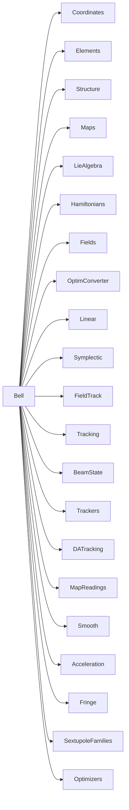

# Карта зависимостей `src/`

Стрелка `A → B` значит: в `src/` модуль `A` зависит от модуля `B`. Ребро берётся из оператора `using` или `import`. `include` ребром не считается: он только вкладывает файл в уже открытый модуль.

Цепочка слоёв, по которой ребро считается направленным к более правому слою, записана в шапке `Bell.jl` и дополнена каталогами, которых в той строке нет:

```text
math → core → io → physics → maps → analysis → tracking → longitudinal_models → optimizers → research
```

`tracking` здесь — каталог `src/tracking` (`BeamState`, `Trackers`). Модуль `Tracking` в `maps/lie/tracking.jl` остаётся в слое `maps`. `NormalForm` лежит в `maps/lie/`, но шапка файла называет его research-слоем: он подключается последним и не входит в `using` фасада `Bell`. На диаграмме он стоит в `research`, справа от `longitudinal_models`.

Сплошная стрелка идёт внутри одного слоя или к более левому слою. Пунктир идёт к более правому слою: это нарушение «нижний зависит от верхнего».

## Диаграмма модулей

```mermaid
flowchart TB
  subgraph mathL["math"]
    DiffAlgebra
    Integrators
  end
  subgraph coreL["core"]
    Coordinates
    Elements
    Structure
    Symplectic
    SextupoleFamilies
  end
  subgraph ioL["io"]
    OptimConverter
  end
  subgraph physL["physics"]
    Hamiltonians
    Fields
    Fringe
  end
  subgraph mapsL["maps"]
    Maps
    LieAlgebra
    Linear
    Tracking
    FieldTrack
    DATracking
  end
  subgraph analysisL["analysis"]
    MapReadings
  end
  subgraph trackIface["tracking"]
    BeamState
    Trackers
  end
  subgraph longL["longitudinal_models"]
    Smooth
    Acceleration
  end
  subgraph optL["optimizers"]
    Optimizers
  end
  subgraph researchL["research"]
    NormalForm
  end

  Integrators --> DiffAlgebra
  Structure --> Coordinates
  Structure --> Elements
  Symplectic --> DiffAlgebra
  Symplectic -.-> LieAlgebra
  SextupoleFamilies --> Coordinates
  SextupoleFamilies --> Elements
  SextupoleFamilies --> Structure
  SextupoleFamilies -.-> LieAlgebra
  SextupoleFamilies -.-> MapReadings
  OptimConverter --> Coordinates
  OptimConverter --> Elements
  OptimConverter --> Structure
  Hamiltonians --> Coordinates
  Hamiltonians --> Elements
  Hamiltonians -.-> LieAlgebra
  Fields --> Coordinates
  Fields --> Elements
  Fringe --> Coordinates
  Fringe --> Elements
  Fringe --> Structure
  Fringe --> Hamiltonians
  Fringe --> Symplectic
  Fringe --> Integrators
  Fringe -.-> LieAlgebra
  Fringe -.-> Linear
  Fringe -.-> Tracking
  Fringe -.-> MapReadings
  Maps --> DiffAlgebra
  LieAlgebra --> Maps
  Linear --> Coordinates
  Linear --> Elements
  Linear --> Structure
  Linear --> Hamiltonians
  Linear --> LieAlgebra
  Tracking --> Coordinates
  Tracking --> Elements
  Tracking --> Structure
  Tracking --> Hamiltonians
  Tracking --> LieAlgebra
  Tracking --> Integrators
  FieldTrack --> Coordinates
  FieldTrack --> Elements
  FieldTrack --> Structure
  FieldTrack --> Fields
  FieldTrack --> Integrators
  DATracking --> DiffAlgebra
  DATracking --> Integrators
  DATracking --> Coordinates
  DATracking --> Elements
  DATracking --> Structure
  DATracking --> Fields
  DATracking --> FieldTrack
  MapReadings --> Coordinates
  MapReadings --> Elements
  MapReadings --> Structure
  MapReadings --> LieAlgebra
  MapReadings --> Linear
  MapReadings --> Tracking
  MapReadings --> DATracking
  MapReadings --> DiffAlgebra
  Trackers --> BeamState
  Trackers --> Structure
  Trackers --> Integrators
  Trackers --> FieldTrack
  Trackers --> Tracking
  Trackers --> LieAlgebra
  Smooth --> Coordinates
  Acceleration --> Coordinates
  Acceleration --> Elements
  Acceleration --> Structure
  Acceleration --> FieldTrack
  NormalForm --> LieAlgebra
  NormalForm --> Coordinates
  NormalForm --> Elements
  NormalForm --> Structure
  NormalForm --> Tracking
  NormalForm --> MapReadings
  NormalForm --> Smooth
  NormalForm --> Linear
```



Два оператора повторяют уже нарисованное ребро и второй стрелки не дают:

- `maps/abstract.jl`: `using ..DiffAlgebra` и `import ..DiffAlgebra` — одна стрелка `Maps → DiffAlgebra`;
- `physics/fringe.jl`: `using ..Tracking` и `import ..Tracking` — одна стрелка `Fringe → Tracking`.

`Coordinates`, `Elements` и `BeamState` не импортируют другие модули Bell. `Optimizers` импортирует только `Random`, `DiffAlgebra` — только `Printf`.

Фасад `Bell` реэкспортирует подмодули отдельным `using` в `Bell.jl`. `DiffAlgebra`, `Integrators` и `NormalForm` в этот список не входят.



## Внешние пакеты

В граф модулей Bell они не входят. `TaylorSeries` — зависимость пакета. `LinearAlgebra`, `Printf` и `Random` — стандартная библиотека Julia.

| Модуль | Файл | Пакеты |
| --- | --- | --- |
| `DiffAlgebra` | `math/DiffAlgebra.jl` | `Printf` |
| `Integrators` | `math/integrators/Integrators.jl` | `LinearAlgebra` |
| `Structure` | `core/structure.jl` | `Printf` |
| `Symplectic` | `core/symplectic.jl` | `TaylorSeries`, `LinearAlgebra` |
| `SextupoleFamilies` | `core/sextupole_families.jl` | `LinearAlgebra`, `TaylorSeries` |
| `Hamiltonians` | `physics/hamiltonians.jl` | `TaylorSeries` |
| `Fringe` | `physics/fringe.jl` | `TaylorSeries`, `LinearAlgebra` |
| `LieAlgebra` | `maps/lie/lie_algebra.jl` | `TaylorSeries`, `LinearAlgebra` |
| `Linear` | `maps/lie/linear.jl` | `LinearAlgebra`, `TaylorSeries` |
| `Tracking` | `maps/lie/tracking.jl` | `TaylorSeries`, `LinearAlgebra` |
| `DATracking` | `maps/da/tracking.jl` | `LinearAlgebra` |
| `NormalForm` | `maps/lie/normal_form.jl` | `LinearAlgebra`, `TaylorSeries` |
| `MapReadings` | `analysis/map_readings.jl` | `TaylorSeries`, `LinearAlgebra` |
| `Optimizers` | `optimizers/Optimizers.jl` | `Random` |

В `src/core/plotting.jl` нет `using` и `import`. Имя `Plots` есть в docstring. Методы графиков лежат в `ext/BellPlotsExt.jl`, это вне `src/`.

Файлы без собственного `using` / `import`, потому что они вложены через `include`:

- `math/lie_series.jl` — внутрь `DiffAlgebra`;
- `math/integrators/rk4.jl`, `dormand_prince.jl`, `gragg_bulirsch_stoer.jl`, `implicit_midpoint.jl`, `yoshida.jl` — внутрь `Integrators`;
- `core/caches.jl` и `core/plotting.jl` — внутрь `Bell`.

## Задуманное разделение

**Модель** — то, что мы задаём. Гамильтониан элемента `H(e, ref, z)` живёт в `Hamiltonians`. Уравнения движения поля — вторая формулировка для сравнения, модуль `Fields`.

**Вычисление** — то, как мы считаем, без своей физики. `DiffAlgebra` и ряды Тейлора (`LieAlgebra` поверх `TaylorSeries`) — алгебры. `Integrators` — общие методы ОДУ. Оба движка принимают модель на вход: путь Ли берёт гамильтониан, путь поля и DA берёт правую часть `dz/ds`.

`Fields` зависит только от `Coordinates` и `Elements`. `Hamiltonians` зависит ещё и от `LieAlgebra`; эта связь стоит в нарушениях.

## Нарушения

Смысл подписан по двум вопросам: ребро смотрит в более правый слой, и физика зависит от построения или чтения карт. Модулей вычисления, которые сами импортируют элементы или физику, в узком наборе алгебр и интеграторов нет: `DiffAlgebra`, `Integrators`, `Maps` и `LieAlgebra` тянут только друг друга и внешние пакеты. Движки карт разобраны ниже, в спорной классификации.

| Файл | Модуль | Зависит от | В чём нарушение |
| --- | --- | --- | --- |
| `physics/hamiltonians.jl` | `Hamiltonians` | `LieAlgebra` | `physics` левее `maps`. Модель гамильтониана зависит от алгебры Lie-пути (`Z`, `JET_ORDER`). |
| `core/symplectic.jl` | `Symplectic` | `LieAlgebra` | `core` левее `maps`. Проверка симплектичности зависит от алгебры карт. |
| `core/sextupole_families.jl` | `SextupoleFamilies` | `LieAlgebra` | `core` левее `maps`. |
| `core/sextupole_families.jl` | `SextupoleFamilies` | `MapReadings` | `core` левее `analysis`. |
| `physics/fringe.jl` | `Fringe` | `LieAlgebra` | `physics` левее `maps`. Модель края зависит от алгебры карт. |
| `physics/fringe.jl` | `Fringe` | `Linear` | `physics` левее `maps`. Модель края зависит от линейных матриц. |
| `physics/fringe.jl` | `Fringe` | `Tracking` | `physics` левее `maps`. Модель края зависит от построения Lie-карт. Тот же модуль назван и в `using`, и в `import`. |
| `physics/fringe.jl` | `Fringe` | `MapReadings` | `physics` левее `analysis`. Модель края зависит от чтения уже построенной карты. |
| `core/caches.jl` | `Bell` | `DATracking`, `Tracking`, `Linear`, `Fringe` | Отдельного `using` нет, стрелки на диаграмме нет. `clear_caches!` в файле слоя `core` опустошает приватные кэши `_DACACHE`, `_SPACES`, `_MCACHE`, `_TMCACHE`, `_HCACHE`, `_RK_STEPS`, `_ECACHE`. |

## Спорная классификация

Эти `using` на диаграмме есть. В таблицу нарушений они не попали.

Движки импортируют решётку и модель:

| Файл | Модуль | Модули Bell |
| --- | --- | --- |
| `maps/lie/linear.jl` | `Linear` | `Coordinates`, `Elements`, `Structure`, `Hamiltonians`, `LieAlgebra` |
| `maps/lie/tracking.jl` | `Tracking` | `Coordinates`, `Elements`, `Structure`, `Hamiltonians`, `LieAlgebra`, `Integrators` |
| `maps/da/field_track.jl` | `FieldTrack` | `Coordinates`, `Elements`, `Structure`, `Fields`, `Integrators` |
| `maps/da/tracking.jl` | `DATracking` | `DiffAlgebra`, `Integrators`, `Coordinates`, `Elements`, `Structure`, `Fields`, `FieldTrack` |

По цепочке слоёв `maps` правее `physics` и `core`, стрелка смотрит влево. Задуманное разделение говорит, что движок принимает модель на вход, поэтому `Tracking → Hamiltonians` и `FieldTrack` / `DATracking → Fields` записаны как этот вход. Буквальное чтение «модуль вычисления зависит от элементов или физики» относит те же четыре файла к нарушениям. В таблицу выше записано первое чтение.

`Fringe → Integrators` и `Fringe → Symplectic` смотрят влево: `physics` может зависеть от `math` и `core`. В нарушения не входят. Сам `Fringe` при этом вызывает метод ОДУ и проверку симплектичности.

`MapReadings` импортирует `Tracking` и `DATracking`. Шапка `analysis/map_readings.jl` говорит, что модуль решётку не интегрирует. Слой `analysis` правее `maps`, стрелка смотрит влево.

`NormalForm → MapReadings` и `NormalForm → Smooth` смотрят влево только потому, что `NormalForm` поставлен в `research`. Если считать его частью `maps` по каталогу `maps/lie/`, оба ребра идут в более правый слой и становятся нарушением.

`using` в `Bell.jl` — реэкспорт фасада и рёбра второй диаграммы. Фасад собирает пакет и стоит над подмодулями, поэтому эти стрелки нарушением слоя не считаются.

## Все операторы `using` и `import`

Каждая внутренняя цель из этой таблицы — стрелка на диаграмме выше. Внешние цели в граф не входили.

| Файл | Модуль | Оператор | Модули Bell | Внешние |
| --- | --- | --- | --- | --- |
| `Bell.jl` | `Bell` | `using` | `Coordinates`, `Elements`, `Structure`, `Maps`, `LieAlgebra`, `Hamiltonians`, `Fields`, `OptimConverter`, `Linear`, `Symplectic`, `FieldTrack`, `Tracking`, `BeamState`, `Trackers`, `DATracking`, `MapReadings`, `Smooth`, `Acceleration`, `Fringe`, `SextupoleFamilies`, `Optimizers` | |
| `math/DiffAlgebra.jl` | `DiffAlgebra` | `using` | | `Printf` |
| `math/integrators/Integrators.jl` | `Integrators` | `using` | | `LinearAlgebra` |
| `math/integrators/Integrators.jl` | `Integrators` | `using` | `DiffAlgebra` | |
| `core/coordinates.jl` | `Coordinates` | | | |
| `core/elements.jl` | `Elements` | | | |
| `core/structure.jl` | `Structure` | `using` | | `Printf` |
| `core/structure.jl` | `Structure` | `using` | `Coordinates`, `Elements` | |
| `core/symplectic.jl` | `Symplectic` | `using` | | `TaylorSeries`, `LinearAlgebra` |
| `core/symplectic.jl` | `Symplectic` | `using` | `LieAlgebra` | |
| `core/symplectic.jl` | `Symplectic` | `using` | `DiffAlgebra` | |
| `core/sextupole_families.jl` | `SextupoleFamilies` | `using` | | `LinearAlgebra`, `TaylorSeries` |
| `core/sextupole_families.jl` | `SextupoleFamilies` | `using` | `Coordinates`, `Elements`, `Structure`, `LieAlgebra`, `MapReadings` | |
| `io/optim_converter.jl` | `OptimConverter` | `using` | `Coordinates`, `Elements`, `Structure` | |
| `physics/hamiltonians.jl` | `Hamiltonians` | `using` | | `TaylorSeries` |
| `physics/hamiltonians.jl` | `Hamiltonians` | `using` | `Coordinates`, `Elements`, `LieAlgebra` | |
| `physics/fields.jl` | `Fields` | `using` | `Coordinates`, `Elements` | |
| `physics/fringe.jl` | `Fringe` | `using` | | `TaylorSeries`, `LinearAlgebra` |
| `physics/fringe.jl` | `Fringe` | `using` | `Coordinates`, `Elements`, `Structure`, `LieAlgebra`, `Hamiltonians`, `Linear`, `Symplectic`, `Tracking`, `MapReadings`, `Integrators` | |
| `physics/fringe.jl` | `Fringe` | `import` | `Tracking` | |
| `maps/abstract.jl` | `Maps` | `using` | `DiffAlgebra` | |
| `maps/abstract.jl` | `Maps` | `import` | `DiffAlgebra` | |
| `maps/lie/lie_algebra.jl` | `LieAlgebra` | `using` | | `TaylorSeries`, `LinearAlgebra` |
| `maps/lie/lie_algebra.jl` | `LieAlgebra` | `using` | `Maps` | |
| `maps/lie/linear.jl` | `Linear` | `using` | | `LinearAlgebra`, `TaylorSeries` |
| `maps/lie/linear.jl` | `Linear` | `using` | `Coordinates`, `Elements`, `Structure`, `Hamiltonians`, `LieAlgebra` | |
| `maps/lie/tracking.jl` | `Tracking` | `using` | | `TaylorSeries`, `LinearAlgebra` |
| `maps/lie/tracking.jl` | `Tracking` | `using` | `Coordinates`, `Elements`, `Structure`, `Hamiltonians`, `LieAlgebra`, `Integrators` | |
| `maps/da/field_track.jl` | `FieldTrack` | `using` | `Coordinates`, `Elements`, `Structure`, `Fields`, `Integrators` | |
| `maps/da/tracking.jl` | `DATracking` | `using` | | `LinearAlgebra` |
| `maps/da/tracking.jl` | `DATracking` | `using` | `DiffAlgebra`, `Integrators` | |
| `maps/da/tracking.jl` | `DATracking` | `using` | `Coordinates`, `Elements`, `Structure`, `Fields`, `FieldTrack` | |
| `maps/lie/normal_form.jl` | `NormalForm` | `using` | | `LinearAlgebra` |
| `maps/lie/normal_form.jl` | `NormalForm` | `using` | | `TaylorSeries` |
| `maps/lie/normal_form.jl` | `NormalForm` | `using` | `LieAlgebra`, `Coordinates`, `Elements`, `Structure`, `Tracking`, `MapReadings`, `Smooth`, `Linear` | |
| `analysis/map_readings.jl` | `MapReadings` | `using` | | `TaylorSeries`, `LinearAlgebra` |
| `analysis/map_readings.jl` | `MapReadings` | `using` | `Coordinates`, `Elements`, `Structure`, `LieAlgebra`, `Linear`, `Tracking`, `DATracking`, `DiffAlgebra` | |
| `tracking/state.jl` | `BeamState` | | | |
| `tracking/trackers.jl` | `Trackers` | `using` | `BeamState` | |
| `tracking/trackers.jl` | `Trackers` | `using` | `Structure` | |
| `tracking/trackers.jl` | `Trackers` | `using` | `Integrators` | |
| `tracking/trackers.jl` | `Trackers` | `using` | `FieldTrack` | |
| `tracking/trackers.jl` | `Trackers` | `using` | `Tracking` | |
| `tracking/trackers.jl` | `Trackers` | `using` | `LieAlgebra` | |
| `longitudinal_models/smooth.jl` | `Smooth` | `using` | `Coordinates` | |
| `longitudinal_models/acceleration.jl` | `Acceleration` | `using` | `Coordinates`, `Elements`, `Structure`, `FieldTrack` | |
| `optimizers/Optimizers.jl` | `Optimizers` | `using` | | `Random` |
